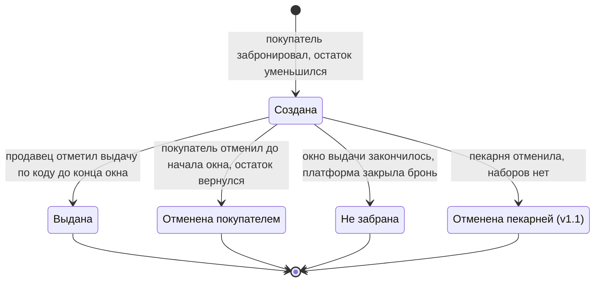

# Требования: «Остатки сладки» — фудшеринг для пекарен

Документ отвечает на четыре вопроса: что строим, для кого, что входит в первую версию и чего сознательно не делаем. Схемы и бэклог живут во внешних сервисах, документ на них ссылается и с ними согласован: номера историй `US-xx` одинаковы в этом файле, на карте историй в Miro и в Jira.

| Артефакт | Где | Что там |
| --- | --- | --- |
| Персоны | [Miro → «Персоны»](https://miro.com/app/board/uXjVEWLd15E=/?moveToWidget=3458764688207577192) | Три карточки: контекст, цель, боли, что важно, ключевые истории |
| Карты пути клиента (CJM) | Miro: [Сосед по району](https://miro.com/app/board/uXjVEWLd15E=/?moveToWidget=3458764688207287295), [Администратор пекарни](https://miro.com/app/board/uXjVEWLd15E=/?moveToWidget=3458764688207440714), [Продавец на смене](https://miro.com/app/board/uXjVEWLd15E=/?moveToWidget=3458764688207427519) | Путь без сервиса: действия, мысли, эмоции, точки контакта, боли и возможности со ссылкой на истории |
| Карта пользовательских историй (USM) | [Miro → «USM»](https://miro.com/app/board/uXjVEWLd15E=/?moveToWidget=3458764688207207039) | Кто действует → шаги пути → истории по релизам MVP, v1.1, v1.2 |
| Бэклог | [Jira, проект SCRUM](https://ostatki.atlassian.net/jira/software/projects/SCRUM/boards/1) | Эпики = активности USM, истории с критериями приёмки, приоритетом MoSCoW и оценкой ICE |
| Как работает команда | [process.md](./process.md) | Роли, Scrum, ветки, определения готовности и завершённости |

## Предметная область

Рассматривали три кандидата. Для каждого заполнена таблица проверки по четырём требованиям курса.

### Кандидат 1: Фудшеринг для пекарен — продажа остатков дня со скидкой

Суть: пекарня к концу дня выставляет нераспроданную выпечку наборами по сниженной цене и с окном выдачи. Покупатели поблизости видят предложения рядом, бронируют набор, получают код выдачи и забирают его до закрытия, оплачивая на месте.

| Требование | Проверка | Итог |
| --- | --- | --- |
| 2–3 ограниченных контекста | «Каталог» (пекарни и предложения) и «Бронирование и выдача» — в MVP; «Уведомления» (подписки, напоминания, лист ожидания) и «Учёт и итоги» — в v1.1 | ✅ два в MVP, четыре к концу семестра |
| Внешняя интеграция | Геокодирование адреса и расстояние до точки — MVP; бот в мессенджере MAX для уведомлений — v1.1; карта в клиенте — v1.2 | ✅ уже в MVP |
| Пользовательский интерфейс | Покупатель: лента предложений рядом, карточка набора, бронь, «мои брони» с кодом. Пекарня: публикация остатков, брони на сегодня, отметка выдачи. Администратор и продавец — две персоны, но одна роль в системе: оба работают в кабинете пекарни | ✅ две роли, два интерфейса |
| Нетривиальные данные | Пекарня → точка → предложение с окном выдачи и остатком; брони с жизненным циклом (создана → выдана / отменена / не забрана); история изменения остатка и цены; подписки на пекарни; лист ожидания | ✅ связи, состояния, история |

**Вывод**: домен проходит.

**Чем это не клон сервисов «спасения еды».** Зарубежные сервисы с «пакетом-сюрпризом» работают с крупными сетями и онлайн-оплатой. Наша логика своя и проверяется на малых пекарнях:

- окно выдачи и код вместо оплаты вперёд (MVP);
- состояние брони «не забрана», которое платформа ставит сама (MVP), и учёт неявок покупателя (v1.1);
- лист ожидания: отменённая бронь сразу предлагается следующему (v1.2);
- ступенчатая скидка, которую пекарня задаёт сама и которая растёт ближе к концу окна выдачи (v1.2);
- итоги для пекарни «что реально остаётся и что забирают» (v1.1).

Решение не известно заранее — есть что проектировать.

### Кандидат 2: Общий список покупок для семьи

| Требование | Проверка | Итог |
| --- | --- | --- |
| 2–3 ограниченных контекста | Список и его участники — один контекст | ❌ |
| Внешняя интеграция | Нет обязательной; уведомления «добавили в список» — украшение | ⚠️ |
| Пользовательский интерфейс | Один экран со списком | ⚠️ |
| Нетривиальные данные | Фактически одна таблица «пункт списка» | ❌ |

**Вывод**: не проходит — нечего проектировать.

### Кандидат 3: Бот-агрегатор скидок супермаркетов

| Требование | Проверка | Итог |
| --- | --- | --- |
| 2–3 ограниченных контекста | Парсинг акций и выдача по запросу — один контекст | ❌ |
| Внешняя интеграция | Парсинг сайтов сетей; хрупко и юридически спорно | ⚠️ |
| Пользовательский интерфейс | Бот — канал взаимодействия, клиентской части нет | ❌ |
| Нетривиальные данные | Своих данных нет, только чужие, пересобираемые каждый день | ❌ |

**Вывод**: не проходит — бот как весь проект, без собственной системы.

### Итоговый выбор

Выбран **кандидат 1**. Домен подлежит утверждению преподавателем.

## Глоссарий

| Термин | Что означает |
| --- | --- |
| **Пекарня** | Заведение, зарегистрированное в системе. В этом семестре — одна точка выдачи на пекарню |
| **Предложение** | Публикация «остатки дня»: название набора, состав, количество наборов, обычная и сниженная цена, окно выдачи |
| **Набор** | Единица предложения. Пекарня собирает его из того, что осталось; покупатель состав не выбирает |
| **Окно выдачи** | Интервал времени, в который набор можно забрать. По его окончании предложение закрывается |
| **Бронь** | Закреплённые за покупателем наборы из предложения. Имеет код выдачи и состояние |
| **Код выдачи** | Короткий код из шести символов, который покупатель называет продавцу. По нему бронь закрывается |
| **Точка выдачи** | Адрес, где пекарня выдаёт наборы. От неё считается расстояние в ленте |
| **Остаток** | Сколько наборов предложения ещё можно забронировать. Уменьшается при брони, возвращается при отмене покупателем; выдача остаток не меняет |
| **Активное предложение** | Предложение, у которого не закончилось окно выдачи и которое пекарня не сняла. В ленте показывается, пока остаток больше нуля |
| **Неявка** | Бронь, перешедшая в «не забрана»: окно выдачи закончилось, а выдачи не было |
| **Подписка** | Связь покупателя с пекарней: покупатель получает уведомление в MAX, когда пекарня выставила остатки (v1.1) |
| **Лист ожидания** | Очередь покупателей на предложение с нулевым остатком. Когда остаток возвращается, первый в очереди получает уведомление (v1.2) |
| **Бот в MAX** | Бот в мессенджере MAX, через который система присылает уведомления: о новых остатках, напоминание о брони, место из листа ожидания (v1.1) |
| **Платформа** | Сама система как участник карты историй. Выполняет действия по времени, без участия человека: закрывает окно выдачи, напоминает, уведомляет |

### Состояния брони

Те же переходы таблицей:

| Из состояния | В состояние | Что произошло | Что меняется | Релиз, история |
| --- | --- | --- | --- | --- |
| — | Создана | Покупатель забронировал наборы | Остаток уменьшается на число наборов в брони | MVP, US-09 |
| Создана | Выдана | Продавец отметил выдачу по коду до конца окна | Бронь закрыта, итог «собрать» в списке дня уменьшается | MVP, US-13 |
| Создана | Отменена покупателем | Покупатель отменил бронь до начала окна выдачи | Остаток возвращается, код выдачи недействителен | MVP, US-16 |
| Создана | Не забрана | Окно выдачи закончилось, выдачи не было; переход делает платформа | Остаток не возвращается — предложение уже закрыто; неявка учитывается (US-15, v1.1) | MVP, US-21 |
| Создана | Отменена пекарней | Пекарня отменила бронь: наборов не оказалось | Покупатель получает уведомление, остаток не возвращается | v1.1, US-17 |

Все состояния, кроме «Создана», конечные. «Отменена пекарней» заложена в модель заранее: модель домена согласуется в модуле 08 и дальше без записи решения не меняется. Лист ожидания (US-22, v1.2) состояний брони не добавляет: он срабатывает, когда остаток возвращается при отмене покупателем.

## Постановка проблемы

**Что**: Пекарня к закрытию остаётся с нераспроданной выпечкой, которую завтра продавать нельзя. Скидка на ценнике в зале помогает мало — о ней узнают только те, кто уже зашёл, а объявления в соцсетях видят поздно. В итоге, по нашей оценке, списывается 5–15 % дневной выпечки — это гипотеза, её проверяет последняя метрика успеха, — а покупатели, готовые забрать её за полцены, живут в соседнем доме и об этом не знают.

**Для кого**: Небольшие пекарни и кондитерские с одной-двумя точками, без собственного приложения и маркетолога, где вечером за прилавком один продавец. И их соседи — люди, живущие или работающие в нескольких минутах ходьбы, которые возвращаются домой в 19–21 час и готовы взять выпечку «что осталось», если уверены, что она их дождётся.

**Зачем**: Пекарня превращает списание в выручку и видит, что у неё реально остаётся по дням. Покупатель за минуту видит актуальные предложения рядом и получает гарантию, что набор отложен именно для него. Продавец выдаёт наборы по коду, а не по переписке в мессенджере.

**Как измерим успех**:

- доля наборов из опубликованных предложений, выданных до конца окна выдачи — цель ≥ 60 % после месяца работы на одной пекарне;
- доля броней, завершившихся выдачей: «выдана» / («выдана» + «не забрана»), отменённые не считаются — цель ≥ 85 %;
- медианное время от публикации предложения до первой брони — цель ≤ 30 минут;
- для пекарни: число списанных единиц выпечки в неделю до и после подключения — считаем вместе с пекарней вручную, потому что до подключения данных в системе нет.

Первые три метрики система считает сама — по состояниям броней и отметкам времени.

## Персоны

Карточки персон — на [доске Miro](https://miro.com/app/board/uXjVEWLd15E=/?moveToWidget=3458764688207577192). Персон три, ролей в системе две: администратор и продавец работают в одном кабинете пекарни.

### Персона: Сосед по району

**Роль и контекст**: Покупатель. Живёт или работает в 5–10 минутах от пекарни. Возвращается домой около 19–20 часов, ужин ещё не куплен. Готов взять выпечку «что осталось» за половину цены, но не готов специально ехать и ждать у прилавка.

**Цель**: По пути домой забрать свежую выпечку дешевле, точно зная, что она есть и что её отложили.

**Как решает задачу сейчас**: Заходит наугад: иногда после 20:00 висит скидка 30 %, иногда полка пуста. Подписан на соцсети пекарни, но запись «остатки со скидкой» видит, когда уже всё разобрали. Один раз писал в личные сообщения «отложите две булки» — отложили не те и не тому.

**Боли**:

- Не знает заранее, есть ли сегодня что-то и почём — узнаёт, только дойдя до прилавка
- Приходит — уже разобрали, или скидка ещё не началась
- Нет уверенности, что отложенное дождётся: договорённость в переписке ничем не подкреплена
- Не понимает, что в «наборе» и подходит ли ему (есть ли орехи, постная ли выпечка)

**Что важно в решении**: за 10 секунд увидеть, что есть рядом, за сколько и до скольки; гарантия, что набор отложен именно ему; понятный состав; отмена в один шаг.

**Ключевые истории**: US-05, US-09, US-16; в v1.1 — US-07, US-10.

### Персона: Администратор пекарни

**Роль и контекст**: Пекарня. Владелец или управляющий пекарни на одну-две точки. Днём решает всё сразу: закупки, персонал, витрина. В конце смены видит, что осталось 8–20 единиц выпечки, и решает, что с ними делать.

**Цель**: Продать остатки хоть за что-то, не обесценивая дневной прайс, и перестать выбрасывать.

**Как решает задачу сейчас**: Ставит скидку на ценнике после 20:00 и пишет сторис. Охват маленький, кто придёт — неизвестно. Часть остатков раздаёт сотрудникам, часть списывает. Сколько остаётся по дням недели — не считает, «примерно столько же».

**Боли**:

- Списание — прямые убытки, и их никто не считает по дням
- Открытая скидка в зале приучает дневных покупателей ждать вечера
- Выставить остатки в соцсети — долго, а эффект непредсказуем
- Не знает заранее, сколько человек придёт, поэтому не может собрать наборы заранее
- Нельзя продать больше, чем есть, а переписка в мессенджере это не контролирует

**Что важно в решении**: выставить остатки за минуту с телефона; видеть, сколько уже забронировано; остаток уменьшается сам; скидка видна только тем, кто ищет остатки, а не всей витрине; в конце недели — цифры «выставили / забрали / не забрали».

**Ключевые истории**: US-01, US-12; в v1.1 — US-04, US-17, US-19.

### Персона: Продавец на смене

**Роль и контекст**: Пекарня. Один за прилавком вечером. Параллельно обслуживает очередь, пробивает чеки, собирает наборы «что осталось» и выдаёт их тем, кто пришёл по брони.

**Цель**: Выдать правильный набор правильному человеку, не споря и не выясняя в переписке.

**Как решает задачу сейчас**: Администратор пересылает скриншоты диалогов: «Маша, две булки, придёт в восемь». Маш две, булок уже нет, одна не пришла. Собранные заранее наборы стоят на полке до закрытия, а потом выбрасываются.

**Боли**:

- Не понимает, кто пришёл по брони и что именно ему отдать
- Спор с покупателем, который «точно бронировал» — проверить нечем
- Собранные наборы простаивают, если бронь не пришла; когда их можно вернуть на витрину — непонятно
- Всё это — в самый загруженный час смены

**Что важно в решении**: список броней на сегодня с кодами и составом; отметить выдачу одним действием; явный момент, когда бронь «сгорела» и набор свободен.

**Ключевые истории**: US-12, US-13, US-21; в v1.2 — US-14.

## Путь клиента

Карты пути клиента для всех трёх персон — на доске Miro (ссылки в начале документа). Они описывают, как всё происходит **сейчас, без сервиса**: строки «Действие», «Мысли», «Эмоции», «Точка контакта», «Боль»; последняя строка «Возможность» — что с этим может сделать система, с номером истории.

Главный сценарий — путь соседа по району с сервисом:

1. **Едет домой** — около 19:30, ужин не куплен, хочет взять что-то к чаю, но не по дневной цене
2. **Открывает сайт** — с телефона, указывает домашний адрес (в следующий раз он запомнен); в v1.1 узнаёт о новых остатках из уведомления в MAX
3. **Видит предложения рядом** — список по расстоянию: пекарня, набор, обычная и сниженная цена, сколько осталось, до скольки выдача (US-05)
4. **Открывает карточку и бронирует** — читает состав, выбирает два набора, подтверждает (T-01, US-09)
5. **Получает код выдачи** — на экране подтверждения и в «моих бронях»: код, адрес, окно выдачи, кнопка отмены (US-09, US-16)
6. **Приходит и называет код** — в окно выдачи, без очереди на выбор и без объяснений
7. **Получает набор** — продавец отмечает выдачу по коду, покупатель платит на месте и забирает (US-13)

### Три самые дорогие боли

По итогам CJM важность болей расставлена так:

1. **Договорённость ничем не подкреплена** (покупатель, продавец). Бронь в переписке не видна продавцу и не ограничена остатком; отсюда споры у прилавка, выданные «не те» наборы и покупатели, которые больше не возвращаются. Закрывается ядром MVP: бронь с кодом (US-09), список на сегодня (US-12), выдача по коду (US-13).
2. **Покупатель не знает, есть ли что-то рядом и до скольки** (покупатель). Без этого воронка не начинается. Закрывается лентой «рядом» с ценой и окном выдачи (US-05), а в v1.1 — подпиской с уведомлением в MAX (US-07) и QR-кодом у кассы (US-23).
3. **Пекарня продаёт больше, чем есть, и не знает, сколько придут** (администратор, продавец). Переписка не считает остаток, наборы собираются «на глаз» и простаивают. Закрывается автоматическим учётом остатка (US-09, US-16) и состоянием «не забрана», которое ставит платформа (US-21), — всё это в MVP.

Боли «нет данных по дням» и «публикация долгая» важны, но не рвут сценарий; они идут в v1.1 (итоги за период — US-19, шаблоны наборов — US-02).

## Карта пользовательских историй

Карта построена по Паттону и в формате доски курса: сверху жёлтые стикеры — **кто действует**, под ними зелёные — **шаги пути**, ниже синие — **истории**, разложенные по релизам горизонтальными полосами. Шаги сгруппированы в шесть активностей; каждая активность — эпик в Jira.

| Активность (эпик Jira) | Шаги пути и кто действует |
| --- | --- |
| [Выставить остатки](https://ostatki.atlassian.net/browse/SCRUM-5) | Администратор: опубликовать остатки; управлять остатком |
| [Найти предложение](https://ostatki.atlassian.net/browse/SCRUM-6) | Покупатель: найти, что есть рядом |
| [Забронировать](https://ostatki.atlassian.net/browse/SCRUM-7) | Покупатель: войти; забронировать набор. Платформа: напомнить |
| [Выдать и забрать](https://ostatki.atlassian.net/browse/SCRUM-8) | Администратор: собрать наборы. Продавец: выдать по коду. Платформа: закрыть окно выдачи |
| [Управлять бронью](https://ostatki.atlassian.net/browse/SCRUM-9) | Покупатель: управлять своей бронью. Администратор: отменить бронь |
| [Подвести итоги](https://ostatki.atlassian.net/browse/SCRUM-10) | Администратор: подвести итоги |

### Истории по релизам

| Релиз | Выставить остатки | Найти предложение | Забронировать | Выдать и забрать | Управлять бронью | Подвести итоги |
| --- | --- | --- | --- | --- | --- | --- |
| **MVP** | US-01 | US-05 | T-01, US-09 | US-12, US-13, US-21 | US-16 | — |
| **v1.1** | US-02, US-04 | US-07, US-23 | US-10 | US-15 | US-17 | US-19 |
| **v1.2** | US-03 | US-06, US-08 | US-11, US-22 | US-14 | US-18 | US-20 |

У активности «Подвести итоги» в MVP истории нет сознательно: проверяемой гипотезе «покупатели придут за забронированным» итоги не нужны, а метрики успеха считаются по состояниям броней без отдельного экрана.

**Позвоночник MVP** — минимальный сквозной путь: пекарня выставила остатки (US-01) → покупатель увидел предложения рядом (US-05) → вошёл и забронировал, получил код (T-01, US-09) → пекарня видит брони на сегодня (US-12) → продавец выдал по коду (US-13); если планы изменились — покупатель отменил до окна (US-16); если не пришёл — платформа перевела бронь в «не забрана» (US-21). Уберём любую историю — сценарий рвётся.

### Бэклог

Формулировка — «Как роль, я хочу что, чтобы зачем»; для действий платформы — «Платформа делает что, чтобы зачем». История описывает, **что** нужно, а не **как** это сделать.

Приоритет — **MoSCoW**: Must — без этого защита не состоится; Should — важно, но можно отложить; Could — режем первым при отставании; Won't — сознательно не делаем (раздел «Вне области охвата»). Внутри одного приоритета порядок задаёт **ICE** = влияние × уверенность × простота, каждый множитель от 1 до 10.

Критерии приёмки «Дано — Когда — Тогда» ведутся в карточке истории в Jira; у историй MVP они есть с момента заведения, у остальных дописываются на планировании спринта (определение готовности — в [process.md](./process.md)).

| ID | История | Релиз | MoSCoW | ICE |
| --- | --- | --- | --- | --- |
| US-01 | Как администратор пекарни, я хочу опубликовать предложение «остатки дня» — название набора, состав, количество, обычную и сниженную цену, окно выдачи, — чтобы покупатели поблизости узнали о нём до закрытия | MVP | Must | 720 |
| US-12 | Как администратор пекарни, я хочу видеть список броней на сегодня — код, количество, состояние, — чтобы собрать наборы к началу окна выдачи | MVP | Must | 648 |
| US-13 | Как продавец, я хочу отметить выдачу по коду, чтобы бронь закрылась, а список дня обновился | MVP | Must | 648 |
| US-09 | Как покупатель, я хочу забронировать один–три набора и получить код выдачи, чтобы быть уверенным, что набор дождётся именно меня | MVP | Must | 630 |
| US-21 | Платформа по окончании окна выдачи переводит невыданные брони в «не забрана», чтобы продавец знал, что набор свободен, а метрики успеха не врали | MVP | Must | 504 |
| US-16 | Как покупатель, я хочу отменить бронь до начала окна выдачи, чтобы наборы вернулись в продажу, а пекарня не собирала их зря | MVP | Must | 504 |
| US-05 | Как покупатель, я хочу видеть список актуальных предложений рядом с указанным адресом — пекарня, расстояние, цена, остаток, окно выдачи — и открыть карточку с составом, чтобы выбрать, куда зайти по пути | MVP | Must | 480 |
| T-01 | Техническая: вход покупателя и кабинет пекарни. Служит US-09 («мои брони»), US-12 и US-13 (кабинет), в v1.1 — US-07 и US-15; способ входа выбирается архитектурным решением в модуле 07 | MVP | Must | 432 |
| US-10 | Платформа за 30 минут до конца окна выдачи присылает покупателю напоминание в MAX, чтобы он не забыл забрать набор | v1.1 | Must | 294 |
| US-07 | Как покупатель, я хочу подписаться на пекарню и получать уведомление в MAX, когда она выставила остатки, чтобы не проверять сайт вручную | v1.1 | Must | 240 |
| US-04 | Как администратор, я хочу изменить количество наборов или снять предложение, чтобы не продать больше, чем есть на самом деле | v1.1 | Should | 384 |
| US-19 | Как администратор, я хочу видеть за период, сколько наборов выставлено, забронировано, выдано и не забрано, чтобы планировать выпечку | v1.1 | Should | 294 |
| US-02 | Как администратор, я хочу сохранять шаблоны наборов, чтобы выставлять остатки за минуту с телефона | v1.1 | Should | 280 |
| US-15 | Платформа временно закрывает бронирование покупателю с тремя неявками подряд, чтобы наборы пекарни не простаивали зря | v1.1 | Should | 252 |
| US-17 | Как администратор, я хочу отменить бронь со своей стороны с уведомлением покупателя, если наборов не оказалось, чтобы человек не пришёл впустую | v1.1 | Should | 245 |
| US-03 | Как администратор, я хочу задать ступенчатую скидку, которая растёт ближе к концу окна выдачи, чтобы распродать всё без ручных правок | v1.2 | Should | 150 |
| US-23 | Как покупатель в зале, я хочу отсканировать QR-код у кассы и сразу подписаться на пекарню, чтобы узнавать о вечерних остатках | v1.1 | Could | 288 |
| US-14 | Как продавец, я хочу сканировать QR-код брони вместо ввода кода, чтобы не ошибаться в очереди | v1.2 | Could | 168 |
| US-18 | Как покупатель, я хочу видеть историю прошлых броней, чтобы вспомнить, где было хорошо | v1.2 | Could | 168 |
| US-08 | Как покупатель, я хочу фильтровать предложения по признакам состава — без орехов, постное, — чтобы не бронировать то, что не смогу есть | v1.2 | Could | 144 |
| US-11 | Как покупатель, я хочу повторить прошлую бронь в той же пекарне в один шаг, чтобы не искать заново | v1.2 | Could | 144 |
| US-22 | Как покупатель, я хочу встать в лист ожидания, если наборы закончились, чтобы получить уведомление в MAX, когда кто-то отменит бронь | v1.2 | Could | 125 |
| US-06 | Как покупатель, я хочу видеть предложения на карте, чтобы понять, что мне по пути | v1.2 | Could | 120 |
| US-20 | Как администратор, я хочу отчёт «сколько наборов спасено от списания» за месяц, чтобы рассказать об этом покупателям | v1.2 | Could | 105 |

US-10 и US-07 — Must, хотя относятся к v1.1: без них нет асинхронного сценария, обязательного по курсу. US-03 — Should при низком ICE: это одно из отличий от аналогов, но проверять его нужно после базовой гипотезы.

**Что режем первым при отставании** — в порядке от наименее важного: Could по возрастанию ICE (US-20, US-06, US-22, US-11, US-08, US-18, US-14, US-23), затем Should. Must не режем никогда.

## Минимально жизнеспособный продукт

Входит:

- Публикация предложения пекарней: название набора, состав, количество, обычная и сниженная цена, окно выдачи (US-01)
- Список актуальных предложений рядом с указанным адресом, с расстоянием, ценой и окном выдачи; карточка с составом (US-05)
- Вход покупателя и кабинет пекарни (T-01)
- Бронь одного–трёх наборов с выдачей кода; остаток предложения уменьшается, при нуле предложение уходит из ленты (US-09)
- Список броней на сегодня для пекарни: код, количество, состояние (US-12)
- Отметка выдачи по коду продавцом (US-13); по окончании окна платформа переводит невыданные брони в «не забрана» (US-21)
- Отмена брони покупателем до начала окна выдачи с возвратом наборов в продажу (US-16)

Критерий: пекарня выставила остатки — сосед нашёл их, забронировал, пришёл и получил набор по коду, — и всё это **без переписки и звонков**. До веб-клиента сценарий проходится через API.

Оплата — на месте, при получении. Это не упрощение «на потом», а решение: проверяемая гипотеза — «покупатели придут за забронированным», и для неё предоплата не нужна.

Вход нужен только для брони. Учётные записи пекарен в этом семестре заводим сами, без самостоятельной регистрации. Покупатель смотрит ленту без входа, а чтобы забронировать — входит: без этого не работают «мои брони», а в v1.1 — подписки (US-07) и учёт неявок (US-15). Способ входа выбираем архитектурным решением в модуле 07.

## Вне области охвата этого семестра

| Не делаем | Почему |
| --- | --- |
| Онлайн-оплата и предоплата | Требует договора с платёжным шлюзом и возвратов; гипотезу «придут ли за бронью» проверяет оплата на месте |
| Доставка и курьеры | Отдельная предметная область; ломает идею «забрать по пути» и экономику набора за 150 рублей |
| Мобильное приложение | Веб-версия с телефона закрывает сценарий; нативный клиент — отдельный объём работы |
| Уведомления по SMS, почте и в других мессенджерах | Одного канала достаточно для проверки асинхронного сценария; команда выбрала бот в MAX |
| Несколько точек одной сети в одном кабинете | Усложняет модель данных и права доступа, не влияет на проверяемую гипотезу |
| Другие типы заведений (кафе, магазины, кулинарии) | Другая номенклатура и правила хранения; сначала доказать на пекарнях |
| Отзывы и рейтинги пекарен | Не влияют на проверяемую гипотезу; у соседней пекарни работает репутация, а не звёзды |
| Передача остатков благотворительным фондам | Другая юридическая схема и другие участники; возможное развитие после семестра |
| Выбор состава набора покупателем | Набор — это «что осталось»; выбор состава возвращает нас к обычному интернет-магазину |
