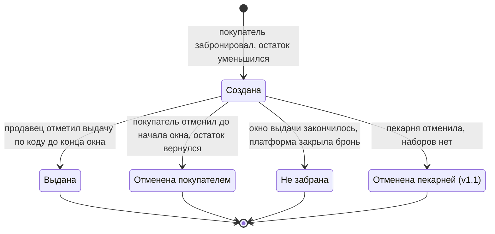

# Требования: «Остатки сладки» — фудшеринг для пекарен

Документ отвечает на четыре вопроса: что строим, для кого, что входит в первую версию и чего сознательно не делаем. Схемы и бэклог живут во внешних сервисах, документ на них ссылается и с ними согласован: номера историй `US-xx` одинаковы в этом файле, на карте историй в Miro и в Jira.

| Артефакт | Где | Что там |
| --- | --- | --- |
| Персоны | [Miro → «Персоны»](https://miro.com/app/board/uXjVEWLd15E=/?moveToWidget=3458764688207577192) | Три карточки: контекст, цель, боли, что важно, ключевые истории |
| Карты пути клиента (CJM) | Miro: [Сосед по району](https://miro.com/app/board/uXjVEWLd15E=/?moveToWidget=3458764688207287295), [Администратор пекарни](https://miro.com/app/board/uXjVEWLd15E=/?moveToWidget=3458764688207440714), [Продавец на смене](https://miro.com/app/board/uXjVEWLd15E=/?moveToWidget=3458764688207427519) | Путь без сервиса: действия, мысли, эмоции, точки контакта, боли и возможности со ссылкой на истории |
| Карта пользовательских историй (USM) | [Miro → «USM»](https://miro.com/app/board/uXjVEWLd15E=/?moveToWidget=3458764688207207039) | Кто действует → шаги пути → истории по релизам MVP, v1.1, v1.2 |
| Бэклог | [Jira, проект SCRUM](https://ostatki.atlassian.net/jira/software/projects/SCRUM/boards/1) | Эпики = активности USM, истории с критериями приёмки, приоритетом MoSCoW и оценкой ICE |
| Как работает команда | [process.md](./process.md) | Роли, Scrum, ветки, определения готовности и завершённости |
| Прослеживаемость | [traceability.md](./traceability.md) | Требование → решение → код → проверка |

С ЛР 2А у каждого требования постоянный идентификатор: `BR-xx` — бизнес-требование, `FR-xx` — функциональное, `NFR-xx` — требование к качеству, `C-xx` — ограничение. Номер истории `US-xx` остаётся связью с картой историй и Jira и указан в заголовке функционального требования.

## Предметная область

Рассматривали три кандидата. Для каждого заполнена таблица проверки по четырём требованиям курса.

### Кандидат 1: Фудшеринг для пекарен — продажа остатков дня со скидкой

Суть: пекарня к концу дня выставляет нераспроданную выпечку наборами по сниженной цене и с окном выдачи. Покупатели поблизости видят предложения рядом, бронируют набор, получают код выдачи и забирают его до закрытия, оплачивая на месте.

| Требование | Проверка | Итог |
| --- | --- | --- |
| 2–3 ограниченных контекста | «Каталог» (пекарни и предложения) и «Бронирование и выдача» — в MVP; «Уведомления» (подписки, напоминания, лист ожидания) и «Учёт и итоги» — в v1.1 | ✅ два в MVP, четыре к концу семестра |
| Внешняя интеграция | Геокодирование адреса и расстояние до точки — MVP; бот в мессенджере MAX для уведомлений — v1.1; карта в клиенте — v1.2 | ✅ уже в MVP |
| Пользовательский интерфейс | Покупатель: лента предложений рядом, карточка набора, бронь, «мои брони» с кодом. Пекарня: публикация остатков, брони на сегодня, отметка выдачи. Администратор и продавец — две персоны, но одна роль в системе: оба работают в кабинете пекарни | ✅ две роли, два интерфейса |
| Нетривиальные данные | Пекарня → точка → предложение с окном выдачи и остатком; брони с жизненным циклом (создана → выдана / отменена / не забрана); история изменения остатка и цены; подписки на пекарни; лист ожидания | ✅ связи, состояния, история |

**Вывод**: домен проходит.

**Чем это не клон сервисов «спасения еды».** Зарубежные сервисы с «пакетом-сюрпризом» работают с крупными сетями и онлайн-оплатой. Наша логика своя и проверяется на малых пекарнях:

- окно выдачи и код вместо оплаты вперёд (MVP);
- состояние брони «не забрана», которое платформа ставит сама (MVP), и учёт неявок покупателя (v1.1);
- лист ожидания: отменённая бронь сразу предлагается следующему (v1.2);
- ступенчатая скидка, которую пекарня задаёт сама и которая растёт ближе к концу окна выдачи (v1.2);
- итоги для пекарни «что реально остаётся и что забирают» (v1.1).

Решение не известно заранее — есть что проектировать.

### Кандидат 2: Общий список покупок для семьи

| Требование | Проверка | Итог |
| --- | --- | --- |
| 2–3 ограниченных контекста | Список и его участники — один контекст | ❌ |
| Внешняя интеграция | Нет обязательной; уведомления «добавили в список» — украшение | ⚠️ |
| Пользовательский интерфейс | Один экран со списком | ⚠️ |
| Нетривиальные данные | Фактически одна таблица «пункт списка» | ❌ |

**Вывод**: не проходит — нечего проектировать.

### Кандидат 3: Бот-агрегатор скидок супермаркетов

| Требование | Проверка | Итог |
| --- | --- | --- |
| 2–3 ограниченных контекста | Парсинг акций и выдача по запросу — один контекст | ❌ |
| Внешняя интеграция | Парсинг сайтов сетей; хрупко и юридически спорно | ⚠️ |
| Пользовательский интерфейс | Бот — канал взаимодействия, клиентской части нет | ❌ |
| Нетривиальные данные | Своих данных нет, только чужие, пересобираемые каждый день | ❌ |

**Вывод**: не проходит — бот как весь проект, без собственной системы.

### Итоговый выбор

Выбран **кандидат 1**. Домен подлежит утверждению преподавателем.

## Глоссарий

| Термин | Что означает |
| --- | --- |
| **Пекарня** | Заведение, зарегистрированное в системе. В этом семестре — одна точка выдачи на пекарню |
| **Предложение** | Публикация «остатки дня»: название набора, состав, количество наборов, обычная и сниженная цена, окно выдачи |
| **Набор** | Единица предложения. Пекарня собирает его из того, что осталось; покупатель состав не выбирает |
| **Окно выдачи** | Интервал времени, в который набор можно забрать. По его окончании предложение закрывается |
| **Бронь** | Закреплённые за покупателем наборы из предложения. Имеет код выдачи и состояние |
| **Код выдачи** | Короткий код из шести символов, который покупатель называет продавцу. По нему бронь закрывается |
| **Точка выдачи** | Адрес, где пекарня выдаёт наборы. От неё считается расстояние в ленте |
| **Остаток** | Сколько наборов предложения ещё можно забронировать. Уменьшается при брони, возвращается при отмене покупателем; выдача остаток не меняет |
| **Активное предложение** | Предложение, у которого не закончилось окно выдачи и которое пекарня не сняла. В ленте показывается, пока остаток больше нуля |
| **Неявка** | Бронь, перешедшая в «не забрана»: окно выдачи закончилось, а выдачи не было |
| **Подписка** | Связь покупателя с пекарней: покупатель получает уведомление в MAX, когда пекарня выставила остатки (v1.1) |
| **Лист ожидания** | Очередь покупателей на предложение с нулевым остатком. Когда остаток возвращается, первый в очереди получает уведомление (v1.2) |
| **Бот в MAX** | Бот в мессенджере MAX, через который система присылает уведомления: о новых остатках, напоминание о брони, место из листа ожидания (v1.1) |
| **Платформа** | Сама система как участник карты историй. Выполняет действия по времени, без участия человека: закрывает окно выдачи, напоминает, уведомляет |

### Состояния брони

Те же переходы таблицей:

| Из состояния | В состояние | Что произошло | Что меняется | Релиз, история |
| --- | --- | --- | --- | --- |
| — | Создана | Покупатель забронировал наборы | Остаток уменьшается на число наборов в брони | MVP, US-09 |
| Создана | Выдана | Продавец отметил выдачу по коду до конца окна | Бронь закрыта, итог «собрать» в списке дня уменьшается | MVP, US-13 |
| Создана | Отменена покупателем | Покупатель отменил бронь до начала окна выдачи | Остаток возвращается, код выдачи недействителен | MVP, US-16 |
| Создана | Не забрана | Окно выдачи закончилось, выдачи не было; переход делает платформа | Остаток не возвращается — предложение уже закрыто; неявка учитывается (US-15, v1.1) | MVP, US-21 |
| Создана | Отменена пекарней | Пекарня отменила бронь: наборов не оказалось | Покупатель получает уведомление, остаток не возвращается | v1.1, US-17 |

Все состояния, кроме «Создана», конечные. «Отменена пекарней» заложена в модель заранее: модель домена согласуется в модуле 08 и дальше без записи решения не меняется. Лист ожидания (US-22, v1.2) состояний брони не добавляет: он срабатывает, когда остаток возвращается при отмене покупателем.

## Постановка проблемы

**Что**: Пекарня к закрытию остаётся с нераспроданной выпечкой, которую завтра продавать нельзя. Скидка на ценнике в зале помогает мало — о ней узнают только те, кто уже зашёл, а объявления в соцсетях видят поздно. В итоге, по нашей оценке, списывается 5–15 % дневной выпечки — это гипотеза, её проверяет последняя метрика успеха, — а покупатели, готовые забрать её за полцены, живут в соседнем доме и об этом не знают.

**Для кого**: Небольшие пекарни и кондитерские с одной-двумя точками, без собственного приложения и маркетолога, где вечером за прилавком один продавец. И их соседи — люди, живущие или работающие в нескольких минутах ходьбы, которые возвращаются домой в 19–21 час и готовы взять выпечку «что осталось», если уверены, что она их дождётся.

**Зачем**: Пекарня превращает списание в выручку и видит, что у неё реально остаётся по дням. Покупатель за минуту видит актуальные предложения рядом и получает гарантию, что набор отложен именно для него. Продавец выдаёт наборы по коду, а не по переписке в мессенджере.

**Как измерим успех**:

- доля наборов из опубликованных предложений, выданных до конца окна выдачи — цель ≥ 60 % после месяца работы на одной пекарне;
- доля броней, завершившихся выдачей: «выдана» / («выдана» + «не забрана»), отменённые не считаются — цель ≥ 85 %;
- медианное время от публикации предложения до первой брони — цель ≤ 30 минут;
- для пекарни: число списанных единиц выпечки в неделю до и после подключения — считаем вместе с пекарней вручную, потому что до подключения данных в системе нет.

Первые три метрики система считает сама — по состояниям броней и отметкам времени. С ЛР 2А они записаны бизнес-требованиями `BR-01`…`BR-03`.

## Заинтересованные стороны

Персоны описывают тех, кто пользуется системой. Здесь перечислены все, кто предъявляет к ней требования, в том числе те, кто ею не пользуется.

| Сторона | Кто это у нас | Интерес | Требования |
| --- | --- | --- | --- |
| Покупатель | Персона «Сосед по району» | Быстро узнать, что есть рядом, и быть уверенным, что набор дождётся | `FR-02`, `FR-03`, `FR-06`, `FR-08`, `FR-09`, `NFR-01`, `NFR-08` |
| Администратор пекарни | Персона «Администратор пекарни» | Выставить остатки за минуту и не продать больше, чем есть | `FR-01`, `FR-04`, `FR-10`, `FR-12`, `FR-14`, `FR-15`, `NFR-04`, `NFR-09` |
| Продавец | Персона «Продавец на смене» | Выдать правильный набор правильному человеку без споров | `FR-05`, `FR-07`, `NFR-03` |
| Заказчик | Владелец пекарни, подключившейся к пилоту | Выручка вместо списания, цифры по дням | `BR-01`…`BR-03`, `FR-11`, `FR-13` |
| Эксплуатация | Команда, когда система запущена | Понятные журналы, работа после перезапуска | `NFR-05`, `NFR-06` |
| Разработка | Команда через два месяца | Менять систему, не переписывая | `NFR-07` |
| Надзор за персональными данными | Требования 152-ФЗ к оператору персональных данных | Минимум персональных данных, их защита, ничего лишнего в журналах | `C-09`, `NFR-02`, `NFR-05` |
| Платформа MAX | Мессенджер, через который идут уведомления | Бот пишет только тем, кто сам его подключил | `C-07`, `FR-08`, `FR-09` |
| Оператор | Команда, когда заводит пекарни и сотрудников (`C-11`) | Подключить пекарню за один раз без ошибок | `FR-31`, `C-11` |
| Кафедра | Преподаватель курса | Проект проходит модули курса на заданном стеке | `C-01`, `C-02`, `C-05`, `C-10` |

Пекарня в системе — две роли (администратор и продавец) и одна сторона-заказчик: интерес владельца — деньги и цифры, интерес сотрудников — быстрая и бесспорная работа в смену.

## Персоны

Карточки персон — на [доске Miro](https://miro.com/app/board/uXjVEWLd15E=/?moveToWidget=3458764688207577192). Персон три, ролей в системе две: администратор и продавец работают в одном кабинете пекарни.

### Персона: Сосед по району

**Роль и контекст**: Покупатель. Живёт или работает в 5–10 минутах от пекарни. Возвращается домой около 19–20 часов, ужин ещё не куплен. Готов взять выпечку «что осталось» за половину цены, но не готов специально ехать и ждать у прилавка.

**Цель**: По пути домой забрать свежую выпечку дешевле, точно зная, что она есть и что её отложили.

**Как решает задачу сейчас**: Заходит наугад: иногда после 20:00 висит скидка 30 %, иногда полка пуста. Подписан на соцсети пекарни, но запись «остатки со скидкой» видит, когда уже всё разобрали. Один раз писал в личные сообщения «отложите две булки» — отложили не те и не тому.

**Боли**:

- Не знает заранее, есть ли сегодня что-то и почём — узнаёт, только дойдя до прилавка
- Приходит — уже разобрали, или скидка ещё не началась
- Нет уверенности, что отложенное дождётся: договорённость в переписке ничем не подкреплена
- Не понимает, что в «наборе» и подходит ли ему (есть ли орехи, постная ли выпечка)

**Что важно в решении**: за 10 секунд увидеть, что есть рядом, за сколько и до скольки; гарантия, что набор отложен именно ему; понятный состав; отмена в один шаг.

**Ключевые истории**: US-05, US-09, US-16; в v1.1 — US-07, US-10.

### Персона: Администратор пекарни

**Роль и контекст**: Пекарня. Владелец или управляющий пекарни на одну-две точки. Днём решает всё сразу: закупки, персонал, витрина. В конце смены видит, что осталось 8–20 единиц выпечки, и решает, что с ними делать.

**Цель**: Продать остатки хоть за что-то, не обесценивая дневной прайс, и перестать выбрасывать.

**Как решает задачу сейчас**: Ставит скидку на ценнике после 20:00 и пишет сторис. Охват маленький, кто придёт — неизвестно. Часть остатков раздаёт сотрудникам, часть списывает. Сколько остаётся по дням недели — не считает, «примерно столько же».

**Боли**:

- Списание — прямые убытки, и их никто не считает по дням
- Открытая скидка в зале приучает дневных покупателей ждать вечера
- Выставить остатки в соцсети — долго, а эффект непредсказуем
- Не знает заранее, сколько человек придёт, поэтому не может собрать наборы заранее
- Нельзя продать больше, чем есть, а переписка в мессенджере это не контролирует

**Что важно в решении**: выставить остатки за минуту с телефона; видеть, сколько уже забронировано; остаток уменьшается сам; скидка видна только тем, кто ищет остатки, а не всей витрине; в конце недели — цифры «выставили / забрали / не забрали».

**Ключевые истории**: US-01, US-12; в v1.1 — US-04, US-17, US-19.

### Персона: Продавец на смене

**Роль и контекст**: Пекарня. Один за прилавком вечером. Параллельно обслуживает очередь, пробивает чеки, собирает наборы «что осталось» и выдаёт их тем, кто пришёл по брони.

**Цель**: Выдать правильный набор правильному человеку, не споря и не выясняя в переписке.

**Как решает задачу сейчас**: Администратор пересылает скриншоты диалогов: «Маша, две булки, придёт в восемь». Маш две, булок уже нет, одна не пришла. Собранные заранее наборы стоят на полке до закрытия, а потом выбрасываются.

**Боли**:

- Не понимает, кто пришёл по брони и что именно ему отдать
- Спор с покупателем, который «точно бронировал» — проверить нечем
- Собранные наборы простаивают, если бронь не пришла; когда их можно вернуть на витрину — непонятно
- Всё это — в самый загруженный час смены

**Что важно в решении**: список броней на сегодня с кодами и составом; отметить выдачу одним действием; явный момент, когда бронь «сгорела» и набор свободен.

**Ключевые истории**: US-12, US-13, US-21; в v1.2 — US-14.

## Путь клиента

Карты пути клиента для всех трёх персон — на доске Miro (ссылки в начале документа). Они описывают, как всё происходит **сейчас, без сервиса**: строки «Действие», «Мысли», «Эмоции», «Точка контакта», «Боль»; последняя строка «Возможность» — что с этим может сделать система, с номером истории.

Главный сценарий — путь соседа по району с сервисом:

1. **Едет домой** — около 19:30, ужин не куплен, хочет взять что-то к чаю, но не по дневной цене
2. **Открывает сайт** — с телефона, указывает домашний адрес (в следующий раз он запомнен); в v1.1 узнаёт о новых остатках из уведомления в MAX
3. **Видит предложения рядом** — список по расстоянию: пекарня, набор, обычная и сниженная цена, сколько осталось, до скольки выдача (US-05)
4. **Открывает карточку и бронирует** — читает состав, выбирает два набора, подтверждает (T-01, US-09)
5. **Получает код выдачи** — на экране подтверждения и в «моих бронях»: код, адрес, окно выдачи, кнопка отмены (US-09, US-16)
6. **Приходит и называет код** — в окно выдачи, без очереди на выбор и без объяснений
7. **Получает набор** — продавец отмечает выдачу по коду, покупатель платит на месте и забирает (US-13)

### Три самые дорогие боли

По итогам CJM важность болей расставлена так:

1. **Договорённость ничем не подкреплена** (покупатель, продавец). Бронь в переписке не видна продавцу и не ограничена остатком; отсюда споры у прилавка, выданные «не те» наборы и покупатели, которые больше не возвращаются. Закрывается ядром MVP: бронь с кодом (US-09), список на сегодня (US-12), выдача по коду (US-13).
2. **Покупатель не знает, есть ли что-то рядом и до скольки** (покупатель). Без этого воронка не начинается. Закрывается лентой «рядом» с ценой и окном выдачи (US-05), а в v1.1 — подпиской с уведомлением в MAX (US-07) и QR-кодом у кассы (US-23).
3. **Пекарня продаёт больше, чем есть, и не знает, сколько придут** (администратор, продавец). Переписка не считает остаток, наборы собираются «на глаз» и простаивают. Закрывается автоматическим учётом остатка (US-09, US-16) и состоянием «не забрана», которое ставит платформа (US-21), — всё это в MVP.

Боли «нет данных по дням» и «публикация долгая» важны, но не рвут сценарий; они идут в v1.1 (итоги за период — US-19, шаблоны наборов — US-02).

## Карта пользовательских историй

Карта построена по Паттону и в формате доски курса: сверху жёлтые стикеры — **кто действует**, под ними зелёные — **шаги пути**, ниже синие — **истории**, разложенные по релизам горизонтальными полосами. Шаги сгруппированы в шесть активностей; каждая активность — эпик в Jira.

| Активность (эпик Jira) | Шаги пути и кто действует |
| --- | --- |
| [Выставить остатки](https://ostatki.atlassian.net/browse/SCRUM-5) | Администратор: опубликовать остатки; управлять остатком |
| [Найти предложение](https://ostatki.atlassian.net/browse/SCRUM-6) | Покупатель: найти, что есть рядом |
| [Забронировать](https://ostatki.atlassian.net/browse/SCRUM-7) | Покупатель: войти; забронировать набор. Платформа: напомнить |
| [Выдать и забрать](https://ostatki.atlassian.net/browse/SCRUM-8) | Администратор: собрать наборы. Продавец: выдать по коду. Платформа: закрыть окно выдачи |
| [Управлять бронью](https://ostatki.atlassian.net/browse/SCRUM-9) | Покупатель: управлять своей бронью. Администратор: отменить бронь |
| [Подвести итоги](https://ostatki.atlassian.net/browse/SCRUM-10) | Администратор: подвести итоги |

### Истории по релизам

| Релиз | Выставить остатки | Найти предложение | Забронировать | Выдать и забрать | Управлять бронью | Подвести итоги |
| --- | --- | --- | --- | --- | --- | --- |
| **MVP** | US-01 | US-05 | T-01, US-09 | US-12, US-13, US-21 | US-16 | — |
| **v1.1** | US-02, US-04 | US-07, US-23 | US-10 | US-15 | US-17 | US-19 |
| **v1.2** | US-03 | US-06, US-08 | US-11, US-22 | US-14 | US-18 | US-20 |

У активности «Подвести итоги» в MVP истории нет сознательно: проверяемой гипотезе «покупатели придут за забронированным» итоги не нужны, а метрики успеха считаются по состояниям броней без отдельного экрана.

**Позвоночник MVP** — минимальный сквозной путь: пекарня выставила остатки (US-01) → покупатель увидел предложения рядом (US-05) → вошёл и забронировал, получил код (T-01, US-09) → пекарня видит брони на сегодня (US-12) → продавец выдал по коду (US-13); если планы изменились — покупатель отменил до окна (US-16); если не пришёл — платформа перевела бронь в «не забрана» (US-21). Уберём любую историю — сценарий рвётся.

### Бэклог

Формулировка — «Как роль, я хочу что, чтобы зачем»; для действий платформы — «Платформа делает что, чтобы зачем». История описывает, **что** нужно, а не **как** это сделать.

Приоритет — **MoSCoW**: Must — без этого защита не состоится; Should — важно, но можно отложить; Could — режем первым при отставании; Won't — сознательно не делаем (раздел «Вне области охвата»). Внутри одного приоритета порядок задаёт **ICE** = влияние × уверенность × простота, каждый множитель от 1 до 10.

Критерии приёмки «Дано — Когда — Тогда» историй `Must` и `Should` записаны в разделе [«Функциональные требования»](#функциональные-требования) и имеют номера `AC-xx.y`; карточка истории в Jira ссылается на требование. У историй `Could` критерии дописываются на планировании спринта (определение готовности — в [process.md](./process.md)).

| ID | История | Релиз | MoSCoW | ICE | Jira |
| --- | --- | --- | --- | --- | --- |
| US-01 | Как администратор пекарни, я хочу опубликовать предложение «остатки дня» — название набора, состав, количество, обычную и сниженную цену, окно выдачи, — чтобы покупатели поблизости узнали о нём до закрытия | MVP | Must | 720 | [SCRUM-12](https://ostatki.atlassian.net/browse/SCRUM-12) |
| US-12 | Как администратор пекарни, я хочу видеть список броней на сегодня — код, количество, состояние, — чтобы собрать наборы к началу окна выдачи | MVP | Must | 648 | [SCRUM-16](https://ostatki.atlassian.net/browse/SCRUM-16) |
| US-13 | Как продавец, я хочу отметить выдачу по коду, чтобы бронь закрылась, а список дня обновился | MVP | Must | 648 | [SCRUM-17](https://ostatki.atlassian.net/browse/SCRUM-17) |
| US-09 | Как покупатель, я хочу забронировать один–три набора и получить код выдачи, чтобы быть уверенным, что набор дождётся именно меня | MVP | Must | 630 | [SCRUM-14](https://ostatki.atlassian.net/browse/SCRUM-14) |
| US-21 | Платформа по окончании окна выдачи переводит невыданные брони в «не забрана», чтобы продавец знал, что набор свободен, а метрики успеха не врали | MVP | Must | 504 | [SCRUM-18](https://ostatki.atlassian.net/browse/SCRUM-18) |
| US-16 | Как покупатель, я хочу отменить бронь до начала окна выдачи, чтобы наборы вернулись в продажу, а пекарня не собирала их зря | MVP | Must | 504 | [SCRUM-19](https://ostatki.atlassian.net/browse/SCRUM-19) |
| US-05 | Как покупатель, я хочу видеть список актуальных предложений рядом с указанным адресом — пекарня, расстояние, цена, остаток, окно выдачи — и открыть карточку с составом, чтобы выбрать, куда зайти по пути | MVP | Must | 480 | [SCRUM-13](https://ostatki.atlassian.net/browse/SCRUM-13) |
| T-01 | Техническая: вход покупателя и кабинет пекарни. Служит US-09 («мои брони»), US-12 и US-13 (кабинет), в v1.1 — US-07 и US-15; способ входа выбирается архитектурным решением в модуле 07 | MVP | Must | 432 | [SCRUM-15](https://ostatki.atlassian.net/browse/SCRUM-15) |
| US-10 | Платформа за 30 минут до конца окна выдачи присылает покупателю напоминание в MAX, чтобы он не забыл забрать набор | v1.1 | Must | 294 | [SCRUM-20](https://ostatki.atlassian.net/browse/SCRUM-20) |
| US-07 | Как покупатель, я хочу подписаться на пекарню и получать уведомление в MAX, когда она выставила остатки, чтобы не проверять сайт вручную | v1.1 | Must | 240 | [SCRUM-21](https://ostatki.atlassian.net/browse/SCRUM-21) |
| US-04 | Как администратор, я хочу изменить количество наборов или снять предложение, чтобы не продать больше, чем есть на самом деле | v1.1 | Should | 384 | [SCRUM-22](https://ostatki.atlassian.net/browse/SCRUM-22) |
| US-19 | Как администратор, я хочу видеть за период, сколько наборов выставлено, забронировано, выдано и не забрано, чтобы планировать выпечку | v1.1 | Should | 294 | [SCRUM-23](https://ostatki.atlassian.net/browse/SCRUM-23) |
| US-02 | Как администратор, я хочу сохранять шаблоны наборов, чтобы выставлять остатки за минуту с телефона | v1.1 | Should | 280 | [SCRUM-24](https://ostatki.atlassian.net/browse/SCRUM-24) |
| US-15 | Платформа временно закрывает бронирование покупателю с тремя неявками подряд, чтобы наборы пекарни не простаивали зря | v1.1 | Should | 252 | [SCRUM-25](https://ostatki.atlassian.net/browse/SCRUM-25) |
| US-17 | Как администратор, я хочу отменить бронь со своей стороны с уведомлением покупателя, если наборов не оказалось, чтобы человек не пришёл впустую | v1.1 | Should | 245 | [SCRUM-26](https://ostatki.atlassian.net/browse/SCRUM-26) |
| US-03 | Как администратор, я хочу задать ступенчатую скидку, которая растёт ближе к концу окна выдачи, чтобы распродать всё без ручных правок | v1.2 | Should | 150 | [SCRUM-28](https://ostatki.atlassian.net/browse/SCRUM-28) |
| US-23 | Как покупатель в зале, я хочу отсканировать QR-код у кассы и сразу подписаться на пекарню, чтобы узнавать о вечерних остатках | v1.1 | Could | 288 | [SCRUM-27](https://ostatki.atlassian.net/browse/SCRUM-27) |
| US-14 | Как продавец, я хочу сканировать QR-код брони вместо ввода кода, чтобы не ошибаться в очереди | v1.2 | Could | 168 | [SCRUM-29](https://ostatki.atlassian.net/browse/SCRUM-29) |
| US-18 | Как покупатель, я хочу видеть историю прошлых броней, чтобы вспомнить, где было хорошо | v1.2 | Could | 168 | [SCRUM-30](https://ostatki.atlassian.net/browse/SCRUM-30) |
| US-08 | Как покупатель, я хочу фильтровать предложения по признакам состава — без орехов, постное, — чтобы не бронировать то, что не смогу есть | v1.2 | Could | 144 | [SCRUM-31](https://ostatki.atlassian.net/browse/SCRUM-31) |
| US-11 | Как покупатель, я хочу повторить прошлую бронь в той же пекарне в один шаг, чтобы не искать заново | v1.2 | Could | 144 | [SCRUM-32](https://ostatki.atlassian.net/browse/SCRUM-32) |
| US-22 | Как покупатель, я хочу встать в лист ожидания, если наборы закончились, чтобы получить уведомление в MAX, когда кто-то отменит бронь | v1.2 | Could | 125 | [SCRUM-33](https://ostatki.atlassian.net/browse/SCRUM-33) |
| US-06 | Как покупатель, я хочу видеть предложения на карте, чтобы понять, что мне по пути | v1.2 | Could | 120 | [SCRUM-35](https://ostatki.atlassian.net/browse/SCRUM-35) |
| US-20 | Как администратор, я хочу отчёт «сколько наборов спасено от списания» за месяц, чтобы рассказать об этом покупателям | v1.2 | Could | 105 | [SCRUM-34](https://ostatki.atlassian.net/browse/SCRUM-34) |

US-10 и US-07 — Must, хотя относятся к v1.1: без них нет асинхронного сценария, обязательного по курсу. US-03 — Should при низком ICE: это одно из отличий от аналогов, но проверять его нужно после базовой гипотезы.

**Что режем первым при отставании** — в порядке от наименее важного: Could по возрастанию ICE (US-20, US-06, US-22, US-11, US-08, US-18, US-14, US-23), затем Should. Must не режем никогда.

## Бизнес-требования

| ID | Требование | Как измерим | Текущее значение |
| --- | --- | --- | --- |
| `BR-01` | Не меньше 60 % наборов из опубликованных предложений выдаются до конца окна выдачи — после месяца работы на одной пекарне | Выданные наборы / наборы в опубликованных предложениях за месяц, по состояниям броней | Замера нет: системы нет. Отправная точка — оценка команды: пекарня списывает 5–15 % дневной выпечки. Это гипотеза; до подключения пекарня вместе с командой считает списание вручную |
| `BR-02` | Не меньше 85 % броней завершаются выдачей | «выдана» / («выдана» + «не забрана») за месяц; отменённые брони не считаются | Замера нет: сейчас договорённости идут в переписке и неявки никто не учитывает. Первое значение — первая неделя пилота |
| `BR-03` | Медианное время от публикации предложения до первой брони — не больше 30 минут | Медиана по предложениям за месяц, по отметкам времени публикации и брони | Замера нет. Есть только наблюдение из персоны «Сосед по району»: запись в соцсетях видят, «когда всё уже разобрали». Персона составлена командой, это не замер |

## Функциональные требования

Идентификаторы присваиваются **навсегда**: отменённое требование помечается отменённым, номер не переиспользуется. Подробно — с проверкой INVEST и критериями приёмки — записаны требования `Must` и `Should`; требования `Could` и `Won't` перечислены в разделе [«Приоритизация»](#приоритизация).

**Общие правила времени**, на которые ссылаются критерии:

- окно выдачи — полуоткрытый интервал `[начало, конец)`: в момент «конец» окно уже закончилось (`AC-05.4`, `AC-07.4`);
- «сегодня» — календарные сутки по местному времени точки выдачи; в этом семестре все точки в Омске, UTC+6 (`AC-01.4`, `AC-04.3`);
- приём броней по предложению закрывается за 15 минут до конца окна выдачи (`AC-03.5`);
- отмена покупателем возможна до начала окна выдачи (`AC-06.2`).

### `FR-01`. Публикация предложения «остатки дня»

**История** (US-01, [SCRUM-12](https://ostatki.atlassian.net/browse/SCRUM-12)): Как администратор пекарни, я хочу опубликовать предложение «остатки дня» — название набора, состав, количество наборов, обычную и сниженную цену, окно выдачи, — чтобы покупатели поблизости узнали о нём до закрытия.

**Сторона**: Администратор пекарни · **Приоритет**: Must · **Релиз**: MVP · **Источник**: персона «Администратор пекарни», CJM, этап «Публикация»

**Проверка INVEST**:

| Свойство | Выполнено | Замечание |
| --- | --- | --- |
| Независимая | Да | Предложение публикуется до появления броней и без них |
| Обсуждаемая | Да | Способ ввода не задан: с нуля, из шаблона (`FR-12`) или повтором вчерашнего |
| Ценная | Да | Начало сквозного пути: без предложения покупателю нечего искать |
| Оцениваемая | Да | Одна запись с проверкой полей |
| Небольшая | Да | Умещается в спринт |
| Проверяемая | Да | Критерии ниже |

**Критерии приёмки**:

**AC-01.1 — положительный случай**
- Дано: администратор пекарни «Колосок» вошёл в кабинет, сейчас 18:10
- Когда: он публикует предложение: «Набор выпечки», состав «2 булочки с корицей, круассан, хлеб», 6 наборов, обычная цена 360 ₽, сниженная 150 ₽, окно выдачи сегодня 19:00–20:30
- Тогда: предложение создано с остатком 6; оно есть в кабинете пекарни и в списке предложений рядом с точкой выдачи «Колоска»

**AC-01.2 — конфликт: повторная отправка**
- Дано: администратор отправил публикацию, а ответ не дошёл из-за сети
- Когда: та же публикация отправлена повторно
- Тогда: предложение одно, а не два; остаток 6

**AC-01.3 — граница: длительность окна**
- Дано: сейчас 18:10
- Когда: окно выдачи 19:00–19:15, 19:00–19:14, 19:00–23:00 или 19:00–23:01
- Тогда: при 15 минутах и при 4 часах предложение создано; при 14 минутах и при 4 часах 1 минуте не создано, ответ называет поле окна и допустимые пределы — от 15 минут до 4 часов

**AC-01.4 — граница: окно в пределах суток**
- Дано: сейчас 18:10
- Когда: окно заканчивается сегодня в 23:59 или завтра в 00:30
- Тогда: первое предложение создано; второе нет — остатки дня выдаются в тот же день по местному времени точки выдачи

**AC-01.5 — недопустимые данные**
- Дано: администратор заполняет предложение
- Когда: окно заканчивается раньше текущего момента; сниженная цена не меньше обычной; цена 0 ₽; количество 0 или больше 50; название или состав пусты
- Тогда: предложение не создано, ответ называет каждое поле с ошибкой, ничего не сохранено

**AC-01.6 — чужая пекарня**
- Дано: сотрудник «Колоска» вошёл в кабинет
- Когда: он публикует предложение от имени пекарни «Хлебница»
- Тогда: предложение не создано; ответ такой же, как для несуществующей пекарни (`NFR-02`)

---

### `FR-02`. Предложения рядом и карточка набора

**История** (US-05, [SCRUM-13](https://ostatki.atlassian.net/browse/SCRUM-13)): Как покупатель, я хочу видеть список актуальных предложений рядом с указанным адресом — пекарня, расстояние, цена, остаток, окно выдачи — и открыть карточку с составом, чтобы выбрать, куда зайти по пути.

**Сторона**: Покупатель · **Приоритет**: Must · **Релиз**: MVP · **Источник**: персона «Сосед по району», CJM, этап «Поиск»; вторая из трёх самых дорогих болей

**Проверка INVEST**:

| Свойство | Выполнено | Замечание |
| --- | --- | --- |
| Независимая | Частично | Нужны опубликованные предложения (`FR-01`). Зависимость по данным, а не по коду: проверяется на подготовленных данных |
| Обсуждаемая | Да | Способ показа не задан: список, карта (`FR-22`, Could) — решение интерфейса |
| Ценная | Да | Без этого воронка не начинается |
| Оцениваемая | Да | Поиск по расстоянию и чтение одного предложения |
| Небольшая | На пределе | Определение координат адреса внешней службой — главный риск истории (П-3). Если не уложится в спринт, делится на «список по координатам» и «поиск адреса» |
| Проверяемая | Да | Критерии ниже |

**Критерии приёмки**:

**AC-02.1 — положительный случай**
- Дано: в радиусе 2 км от адреса покупателя три активных предложения; ещё одно — в 10 км; ещё одно — с закончившимся окном выдачи
- Когда: покупатель указывает адрес и запрашивает предложения рядом
- Тогда: он получает три предложения по возрастанию расстояния; у каждого — пекарня, расстояние по прямой от адреса до точки выдачи, обычная и сниженная цена, остаток, окно выдачи; далёкое и закончившееся не показаны. Вход не нужен

**AC-02.2 — граница: радиус, остаток, конец окна**
- Дано: предложения на расстоянии ровно 2,0 км и 2,1 км; предложение с остатком 0; предложение, окно которого заканчивается ровно в момент запроса
- Когда: покупатель запрашивает предложения рядом
- Тогда: показано только предложение на 2,0 км — радиус включает границу; с остатком 0 и с закончившимся окном не показаны

**AC-02.3 — рядом ничего нет**
- Дано: в радиусе 2 км нет активных предложений
- Когда: покупатель запрашивает предложения рядом
- Тогда: он видит сообщение «Рядом пока ничего нет» и может посмотреть все активные предложения города по возрастанию расстояния; пустой список без пояснения не показывается

**AC-02.4 — недопустимые данные: адрес не распознан**
- Дано: покупатель вводит «дом у реки»
- Когда: подтверждает ввод
- Тогда: показано «Не удалось найти адрес, уточните улицу и дом»; список не показан; введённый текст сохраняется для исправления

**AC-02.5 — конфликт: наборы закончились после показа списка**
- Дано: покупатель получил список, где у предложения остаток 1, после чего последний набор забронировал другой покупатель
- Когда: первый покупатель открывает карточку этого предложения
- Тогда: карточка показывает «Наборы закончились», бронь не предлагается; в следующем запросе списка предложения нет

**AC-02.6 — карточка набора**
- Дано: активное предложение с остатком 3
- Когда: покупатель без входа открывает его карточку
- Тогда: он видит пекарню, адрес точки выдачи, название и состав набора, обычную и сниженную цену, остаток и окно выдачи

**AC-02.7 — адрес не вводится повторно** *(найдено обратной проверкой, см. [traceability.md](./traceability.md))*
- Дано: вчера покупатель искал предложения по адресу «ул. Ленина, 10»
- Когда: он снова открывает поиск с того же устройства
- Тогда: список сразу строится для «ул. Ленина, 10»; адрес можно сменить

---

### `FR-03`. Бронь одного–трёх наборов с кодом выдачи

**История** (US-09, [SCRUM-14](https://ostatki.atlassian.net/browse/SCRUM-14)): Как покупатель, я хочу забронировать один–три набора и получить код выдачи, чтобы быть уверенным, что набор дождётся именно меня.

**Сторона**: Покупатель · **Приоритет**: Must · **Релиз**: MVP · **Источник**: персона «Сосед по району», CJM, этап «Бронирование»; первая из трёх самых дорогих болей

**Проверка INVEST**:

| Свойство | Выполнено | Замечание |
| --- | --- | --- |
| Независимая | Частично | Нужны предложение (`FR-01`) и вход покупателя (`NFR-02`, T-01). Вход — техническая задача того же релиза; без него история проверяется на подготовленной учётной записи |
| Обсуждаемая | Да | Как показывается код, не задано |
| Ценная | Да | Ядро продукта: гарантия вместо переписки |
| Оцениваемая | Да | Изменение остатка и создание брони |
| Небольшая | Да | Умещается в спринт |
| Проверяемая | Да | Критерии ниже |

**Критерии приёмки**:

**AC-03.1 — положительный случай**
- Дано: у предложения остаток 4, сейчас 18:30, окно выдачи 19:00–20:30; покупатель вошёл
- Когда: он бронирует 2 набора
- Тогда: бронь создана в состоянии «создана»; остаток предложения 2; покупатель получает код выдачи из шести знаков, адрес точки выдачи и окно выдачи; бронь с тем же кодом есть в его «моих бронях»

**AC-03.2 — конфликт: последний набор забрали**
- Дано: покупатель открыл карточку при остатке 1, после чего другой покупатель забронировал последний набор
- Когда: первый покупатель подтверждает бронь
- Тогда: бронь не создана, ответ «Наборы закончились»; остаток остаётся 0

**AC-03.3 — конфликт: просят больше, чем осталось**
- Дано: остаток 2
- Когда: покупатель бронирует 3 набора
- Тогда: бронь не создана, ответ называет доступное количество — 2

**AC-03.4 — граница: не больше трёх наборов**
- Дано: остаток 10
- Когда: покупатель бронирует 3 набора или 4 набора
- Тогда: на 3 набора бронь создана; на 4 — нет, ответ «Не больше 3 наборов в одной брони»

**AC-03.5 — граница: закрытие приёма броней**
- Дано: окно выдачи 19:00–20:30, остаток есть
- Когда: покупатель бронирует в 20:14:59 или в 20:15:00
- Тогда: в 20:14:59 бронь создана; в 20:15:00 нет — ответ «Приём броней закрыт: до конца выдачи меньше 15 минут»

**AC-03.6 — одна активная бронь на предложение**
- Дано: у покупателя есть бронь в состоянии «создана» на это предложение
- Когда: он бронирует ещё
- Тогда: вторая бронь не создана; ответ показывает существующую бронь. Иначе предел из `AC-03.4` обходился бы несколькими бронями

**AC-03.7 — повтор**
- Дано: покупатель подтвердил бронь, ответ не дошёл
- Когда: тот же запрос отправлен повторно
- Тогда: бронь одна; оба ответа возвращают один и тот же код; остаток уменьшен один раз

**AC-03.8 — недопустимые данные**
- Дано: остаток 4
- Когда: количество 0, −1, 1,5 или не число
- Тогда: бронь не создана, ответ называет поле количества, остаток не изменился

**AC-03.9 — бронь без входа**
- Дано: покупатель не вошёл
- Когда: он подтверждает бронь
- Тогда: бронь не создана, предложен вход; после входа покупатель возвращается к подтверждению той же брони (`NFR-02`)

---

### `FR-04`. Брони на сегодня

**История** (US-12, [SCRUM-16](https://ostatki.atlassian.net/browse/SCRUM-16)): Как администратор пекарни, я хочу видеть список броней на сегодня — код, количество, состояние, — чтобы собрать наборы к началу окна выдачи.

**Сторона**: Администратор пекарни, Продавец · **Приоритет**: Must · **Релиз**: MVP · **Источник**: персоны «Администратор пекарни» и «Продавец на смене», CJM, этапы «Сборка» и «Подготовка»

**Проверка INVEST**:

| Свойство | Выполнено | Замечание |
| --- | --- | --- |
| Независимая | Нет | Без броней (`FR-03`) список пуст. Принято: зависимость по данным, проверяется на подготовленных бронях |
| Обсуждаемая | Да | Вид списка и группировка не заданы |
| Ценная | Да | Без списка пекарня не знает, сколько наборов собрать к началу окна — третья из трёх самых дорогих болей |
| Оцениваемая | Да | Один запрос с отбором по пекарне и дню |
| Небольшая | Да | Меньше спринта |
| Проверяемая | Да | Критерии ниже |

**Критерии приёмки**:

**AC-04.1 — положительный случай**
- Дано: на сегодняшнее предложение три брони: две «создана» (на 2 и на 1 набор) и одна «отменена покупателем»
- Когда: сотрудник пекарни запрашивает брони на сегодня
- Тогда: он видит две брони с кодом, количеством и временем создания и итог «собрать: 3 набора»; отменённая показана отдельно и в итог не входит

**AC-04.2 — броней нет**
- Дано: предложение опубликовано, броней нет
- Когда: сотрудник запрашивает брони на сегодня
- Тогда: ответ «Броней пока нет» вместе с текущим остатком и окном выдачи

**AC-04.3 — граница: сутки**
- Дано: вчера было 5 броней, сегодня новое предложение; сейчас 00:00:00 по местному времени точки выдачи
- Когда: сотрудник запрашивает брони на сегодня
- Тогда: вчерашних броней нет — они попадут в итоги за период (`FR-11`)

**AC-04.4 — конфликт: бронь отменили, пока собирали**
- Дано: сотрудник получил список, после чего покупатель отменил бронь на 2 набора
- Когда: сотрудник запрашивает список ещё раз
- Тогда: бронь показана «отменена покупателем» со временем отмены, итог «собрать» уменьшился на 2

**AC-04.5 — выданные и не забранные**
- Дано: одна бронь выдана в 19:12, другая не выдана, окно закончилось в 20:30
- Когда: сотрудник запрашивает список в 20:31
- Тогда: первая показана «выдана в 19:12», вторая «не забрана»; ни одна не входит в итог «собрать»

**AC-04.6 — недопустимые данные: чужая пекарня**
- Дано: сотрудник «Колоска»
- Когда: запрашивает брони пекарни «Хлебница»
- Тогда: ответ как для несуществующей пекарни, данные не раскрываются (`NFR-02`)

---

### `FR-05`. Выдача по коду

**История** (US-13, [SCRUM-17](https://ostatki.atlassian.net/browse/SCRUM-17)): Как продавец, я хочу отметить выдачу по коду, чтобы бронь закрылась, а список дня обновился.

**Сторона**: Продавец · **Приоритет**: Must · **Релиз**: MVP · **Источник**: персона «Продавец на смене», CJM, этапы «Сверка» и «Выдача»

**Проверка INVEST**:

| Свойство | Выполнено | Замечание |
| --- | --- | --- |
| Независимая | Частично | Нужна бронь (`FR-03`); зависимость по данным |
| Обсуждаемая | Да | Способ ввода кода не задан: вручную или сканированием (`FR-17`, Could) |
| Ценная | Да | Снимает спор у прилавка: проверить бронь есть чем |
| Оцениваемая | Да | Поиск брони по коду и смена состояния |
| Небольшая | Да | Меньше спринта |
| Проверяемая | Да | Критерии ниже |

**Критерии приёмки**:

**AC-05.1 — положительный случай**
- Дано: бронь с кодом `A7K3PQ` в состоянии «создана», окно выдачи 19:00–20:30, сейчас 19:12
- Когда: продавец вводит код и подтверждает выдачу
- Тогда: бронь «выдана» с отметкой 19:12 и указанием, кто выдал; в списке на сегодня она перешла из «собрать» в «выдано», итог «собрать» уменьшился на её количество

**AC-05.2 — код не найден или бронь уже выдана**
- Дано: код, которого нет среди броней пекарни, или код брони в состоянии «выдана»
- Когда: продавец подтверждает выдачу
- Тогда: состояние ни одной брони не меняется; ответ «Бронь не найдена» или «Уже выдана в 19:12»

**AC-05.3 — бронь не забрана**
- Дано: окно выдачи закончилось, бронь «не забрана» (`FR-07`)
- Когда: продавец вводит её код
- Тогда: выдача не выполнена, ответ «Окно выдачи закончилось, бронь не забрана», состояние не меняется

**AC-05.4 — граница: окно выдачи**
- Дано: бронь «создана», окно 19:00–20:30
- Когда: продавец подтверждает выдачу в 18:59:59, 19:00:00, 20:29:59 или 20:30:00
- Тогда: в 19:00:00 и 20:29:59 бронь выдана; в 18:59:59 нет — ответ «Выдача с 19:00»; в 20:30:00 нет — бронь уже «не забрана»

**AC-05.5 — конфликт: два сотрудника вводят один код**
- Дано: бронь «создана»; администратор и продавец одновременно подтверждают выдачу по её коду
- Когда: оба запроса обработаны
- Тогда: бронь выдана один раз; второй получает «Уже выдана в 19:12»

**AC-05.6 — недопустимые данные**
- Дано: продавец вводит код
- Когда: в коде не 6 знаков или есть недопустимые символы
- Тогда: поиск не выполняется, ответ «Код — 6 знаков: латинские буквы и цифры». Строчные буквы считаются заглавными: `a7k3pq` — то же, что `A7K3PQ`

**AC-05.7 — код брони другой пекарни**
- Дано: код существует, но бронь в пекарне «Хлебница»
- Когда: продавец «Колоска» подтверждает выдачу
- Тогда: ответ «Бронь не найдена»: поиск идёт только среди броней своей пекарни

---

### `FR-06`. Отмена брони покупателем

**История** (US-16, [SCRUM-19](https://ostatki.atlassian.net/browse/SCRUM-19)): Как покупатель, я хочу отменить бронь до начала окна выдачи, чтобы наборы вернулись в продажу, а пекарня не собирала их зря.

**Сторона**: Покупатель · **Приоритет**: Must · **Релиз**: MVP · **Источник**: персона «Сосед по району»; третья из трёх самых дорогих болей (остаток возвращается сам)

**Проверка INVEST**:

| Свойство | Выполнено | Замечание |
| --- | --- | --- |
| Независимая | Частично | Нужна бронь (`FR-03`); зависимость по данным |
| Обсуждаемая | Да | Требуется ли подтверждение отмены — решение интерфейса |
| Ценная | Да | Наборы возвращаются в продажу, пекарня не собирает их зря |
| Оцениваемая | Да | Смена состояния и возврат остатка |
| Небольшая | Да | Меньше спринта |
| Проверяемая | Да | Критерии ниже |

**Критерии приёмки**:

**AC-06.1 — положительный случай**
- Дано: бронь на 2 набора «создана», до начала окна выдачи 40 минут; у предложения остаток 0, в списке рядом его нет
- Когда: покупатель отменяет бронь
- Тогда: бронь «отменена покупателем» с отметкой времени; остаток 2; предложение снова в списке рядом; код этой брони больше не действует

**AC-06.2 — граница: начало окна выдачи**
- Дано: бронь «создана», окно выдачи 19:00–20:30
- Когда: покупатель отменяет в 18:59:59 или в 19:00:00
- Тогда: в 18:59:59 бронь отменена; в 19:00:00 нет — ответ «Отмена возможна до начала окна выдачи. Если не придёте, бронь станет „не забрана“ в 20:30»

**AC-06.3 — бронь уже в конечном состоянии**
- Дано: бронь «выдана», «не забрана» или уже «отменена покупателем»
- Когда: покупатель открывает её в «моих бронях»
- Тогда: он видит состояние и время перехода; отменить нельзя, остаток не меняется

**AC-06.4 — конфликт: повторная отмена**
- Дано: бронь на 2 набора «создана»
- Когда: покупатель отменяет её одновременно с телефона и с компьютера
- Тогда: бронь отменена один раз; остаток увеличился на 2, а не на 4

**AC-06.5 — недопустимые данные: чужая или несуществующая бронь**
- Дано: бронь принадлежит другому покупателю или не существует
- Когда: покупатель запрашивает её отмену
- Тогда: ответ «Бронь не найдена», ничего не меняется (`NFR-02`)

---

### `FR-07`. Невыданная бронь становится «не забрана»

**История** (US-21, [SCRUM-18](https://ostatki.atlassian.net/browse/SCRUM-18)): Платформа по окончании окна выдачи переводит невыданные брони в «не забрана», чтобы продавец знал, что набор свободен, а метрики успеха не врали.

**Сторона**: Продавец, Заказчик · **Приоритет**: Must · **Релиз**: MVP · **Источник**: персона «Продавец на смене», CJM, этап «Неявка»; метрика `BR-02` считается по этому состоянию

**Проверка INVEST**:

| Свойство | Выполнено | Замечание |
| --- | --- | --- |
| Независимая | Частично | Нужна бронь (`FR-03`); зависимость по данным |
| Обсуждаемая | Да | Как именно наступает переход — по расписанию или при чтении — не задано: это решение (`К-2`, ЛР 2В) |
| Ценная | Да | Продавец знает, что набор свободен; без этого `BR-02` не считается |
| Оцениваемая | Да | Правило перехода по времени |
| Небольшая | Да | Меньше спринта |
| Проверяемая | Да | Критерии ниже |

**Критерии приёмки**:

**AC-07.1 — положительный случай**
- Дано: бронь «создана», окно выдачи 19:00–20:30, выдачи не было
- Когда: наступает 20:30:00
- Тогда: бронь «не забрана», момент перехода — 20:30:00; выдача по её коду невозможна; сотрудник видит её в списке дня как «не забрана»; остаток не возвращается — предложение закрыто

**AC-07.2 — выданные и отменённые не меняются**
- Дано: у предложения одна бронь «выдана» и одна «отменена покупателем»
- Когда: окно выдачи заканчивается
- Тогда: их состояния не меняются

**AC-07.3 — выдача в последние секунды**
- Дано: продавец отметил выдачу в 20:29:50
- Когда: наступает 20:30:00
- Тогда: бронь остаётся «выдана»

**AC-07.4 — граница: момент конца окна**
- Дано: бронь «создана», окно 19:00–20:30
- Когда: состояние брони запрашивается в 20:29:59 и в 20:30:00
- Тогда: в 20:29:59 — «создана», в 20:30:00 — «не забрана», без задержки

**AC-07.5 — конфликт: выдача против конца окна**
- Дано: бронь «создана», окно заканчивается в 20:30:00
- Когда: запрос выдачи приходит в 20:30:00,2
- Тогда: выдача отклонена, бронь «не забрана» (согласовано с `AC-05.4`)

**AC-07.6 — недопустимая команда**
- Дано: бронь «создана» или «не забрана»
- Когда: кто-либо запрашивает перевод в «не забрана» или обратно вручную
- Тогда: запрос отклонён: состояние «не забрана» наступает только по времени

---

### `FR-08`. Напоминание в MAX за 30 минут до конца окна

**История** (US-10, [SCRUM-20](https://ostatki.atlassian.net/browse/SCRUM-20)): Платформа за 30 минут до конца окна выдачи присылает покупателю напоминание в MAX, чтобы он не забыл забрать набор.

**Сторона**: Покупатель, Заказчик · **Приоритет**: Must · **Релиз**: v1.1 · **Источник**: персона «Сосед по району»; `BR-02`; `C-10` — асинхронный сценарий обязателен по курсу

**Проверка INVEST**:

| Свойство | Выполнено | Замечание |
| --- | --- | --- |
| Независимая | Нет | Нужно подключение покупателя к боту — общая часть с `FR-09`. Принято: подключение входит в ту из двух историй, которая будет сделана первой |
| Обсуждаемая | Да | Текст напоминания не задан |
| Ценная | Да | Меньше неявок — `BR-02` |
| Оцениваемая | Да | После того как выбрано устройство асинхронной обработки (ЛР 6А) |
| Небольшая | Да | При готовом подключении к боту |
| Проверяемая | Да | Критерии ниже |

**Критерии приёмки**:

**AC-08.1 — положительный случай**
- Дано: покупатель подключил бот; бронь создана в 18:30, окно выдачи заканчивается в 20:30
- Когда: наступает 20:00
- Тогда: покупатель получает одно напоминание: пекарня, адрес, код выдачи, время конца окна

**AC-08.2 — бронь уже закрыта**
- Дано: бронь выдана или отменена до 20:00
- Когда: наступает 20:00
- Тогда: напоминание не отправляется

**AC-08.3 — граница: бронь сделана меньше чем за 30 минут**
- Дано: окно заканчивается в 20:30
- Когда: бронь создана в 19:59:59 или в 20:00:00
- Тогда: для первой напоминание отправляется в 20:00; для второй не отправляется — покупатель только что бронировал

**AC-08.4 — отказ: MAX недоступен**
- Дано: в 20:00 служба MAX не отвечает
- Когда: отправка напоминания не удалась
- Тогда: бронь не меняется; отправка повторяется (`NFR-08`); если повторы не помогли, отказ записан в журнал

**AC-08.5 — конфликт: повторы не дублируют**
- Дано: первая попытка отправки дошла, но подтверждение от MAX потерялось
- Когда: выполняется повтор
- Тогда: покупатель получает напоминание о брони не больше одного раза

**AC-08.6 — недопустимые данные: бот не подключён**
- Дано: покупатель не подключал бот
- Когда: наступает время напоминания
- Тогда: напоминание не отправляется, бронь работает как обычно; в «моих бронях» покупателю предложено подключить бот

---

### `FR-09`. Подписка на пекарню и уведомление в MAX

**История** (US-07, [SCRUM-21](https://ostatki.atlassian.net/browse/SCRUM-21)): Как покупатель, я хочу подписаться на пекарню и получать уведомление в MAX, когда она выставила остатки, чтобы не проверять сайт вручную.

**Сторона**: Покупатель, Заказчик · **Приоритет**: Must · **Релиз**: v1.1 · **Источник**: персона «Сосед по району»; `BR-03`; `C-10`

**Проверка INVEST**:

| Свойство | Выполнено | Замечание |
| --- | --- | --- |
| Независимая | Нет | Общая с `FR-08` часть — подключение к боту (см. там) |
| Обсуждаемая | Да | Частота и вид уведомления не заданы |
| Ценная | Да | Покупатель узнаёт об остатках сразу — `BR-03` |
| Оцениваемая | Да | |
| Небольшая | Да | |
| Проверяемая | Да | Критерии ниже |

**Критерии приёмки**:

**AC-09.1 — положительный случай**
- Дано: покупатель подписан на «Колосок» и подключил бот
- Когда: «Колосок» публикует предложение
- Тогда: покупатель получает одно уведомление: набор, обычная и сниженная цена, окно выдачи, ссылка на карточку

**AC-09.2 — отписка**
- Дано: покупатель отписался от «Колоска»
- Когда: «Колосок» публикует предложение
- Тогда: уведомление не приходит

**AC-09.3 — граница: предложение уже недоступно**
- Дано: предложение опубликовано, но к моменту отправки уведомления остаток 0 или приём броней закрыт
- Когда: наступает очередь отправки
- Тогда: уведомление не отправляется

**AC-09.4 — конфликт: подписка дважды**
- Дано: покупатель уже подписан на «Колосок»
- Когда: он подписывается ещё раз
- Тогда: подписка одна, о каждой публикации приходит одно уведомление

**AC-09.5 — недопустимые данные**
- Дано: пекарни нет, или покупатель не вошёл, или бот не подключён
- Когда: покупатель подписывается
- Тогда: на несуществующую пекарню — «не найдено»; без входа — предложен вход; без бота подписка сохранена, покупателю сказано, что уведомления начнутся после подключения бота

---

### `FR-31`. Заведение пекарни оператором

*Добавлено в ЛР 2Г: сверка модели данных с требованиями нашла таблицы пекарен, точек выдачи и сотрудников, которых не создаёт ни одно требование.*

**История**: Как оператор платформы, я хочу завести пекарню с точкой выдачи и учётными записями сотрудников, чтобы пекарня могла публиковать остатки с первого вечера.

**Сторона**: Оператор · **Приоритет**: Must · **Релиз**: MVP · **Источник**: `C-11` — пекарни заводит команда; сверка модели данных (ЛР 2Г)

**Проверка INVEST**:

| Свойство | Выполнено | Замечание |
| --- | --- | --- |
| Независимая | Да | Не зависит от других требований; от неё зависят все остальные |
| Обсуждаемая | Да | Способ — команда на сервере или загрузка файла — не задан |
| Ценная | Да | Без пекарни в системе нечего публиковать |
| Оцениваемая | Да | Три записи и определение координат |
| Небольшая | Да | Меньше спринта |
| Проверяемая | Да | Критерии ниже |

**Критерии приёмки**:

**AC-31.1 — положительный случай**
- Дано: пекарни «Колосок» в системе нет
- Когда: оператор заводит её с адресом «ул. Ленина, 10» и администратором с почтой `admin@kolosok.example`
- Тогда: есть пекарня, точка выдачи с координатами и учётная запись администратора; администратор входит и публикует предложение

**AC-31.2 — недопустимые данные: адрес не распознан**
- Дано: служба координат не находит адрес
- Когда: оператор заводит пекарню
- Тогда: ничего не создано, ответ называет адрес: пекарня без координат не участвует в поиске рядом

**AC-31.3 — граница: одна точка выдачи**
- Дано: у «Колоска» есть точка выдачи
- Когда: оператор добавляет вторую
- Тогда: отказ — одна точка на пекарню (`C-11`)

**AC-31.4 — конфликт: почта уже занята**
- Дано: учётная запись с почтой сотрудника уже есть
- Когда: оператор заводит пекарню с этой почтой
- Тогда: ничего не создано, ответ называет почту

**AC-31.5 — недопустимые данные: нет администратора**
- Дано: оператор заводит пекарню
- Когда: в ней нет ни одного администратора или пусто название
- Тогда: ничего не создано

**AC-31.6 — отключение сотрудника**
- Дано: продавец вошёл в кабинет
- Когда: оператор отключает его учётную запись
- Тогда: не позже чем через 15 минут его запросы получают отказ (`NFR-02`)

---

### Требования `Should`

Записаны короче: история, сторона и источник — в бэклоге выше и в карточке Jira; здесь — проверка INVEST одной строкой и критерии приёмки.

#### `FR-10`. Изменить количество или снять предложение

US-04, [SCRUM-22](https://ostatki.atlassian.net/browse/SCRUM-22) · **Сторона**: Администратор · **Релиз**: v1.1 · **INVEST**: пройдена; зависит от `FR-01` по данным.

- **AC-10.1 — положительный случай.** Дано: 6 наборов, забронировано 2, остаток 4. Когда: администратор меняет количество на 4. Тогда: количество 4, остаток 2
- **AC-10.2 — граница.** Дано: забронировано 2. Когда: количество меняют на 2 или на 1. Тогда: на 2 — принято, остаток 0; на 1 — отказ «Уже забронировано 2 набора»
- **AC-10.3 — конфликт.** Дано: остаток 1. Когда: покупатель бронирует 1 набор одновременно с уменьшением количества на 1. Тогда: выполняется только одно из двух действий, сумма наборов в бронях не превышает количество (`NFR-04`)
- **AC-10.4 — недопустимые данные.** Когда: количество 0 или больше 50; снятие предложения с активными бронями. Тогда: отказ; снять можно только без броней в состоянии «создана», иначе сначала отменить их (`FR-14`)

#### `FR-11`. Итоги за период

US-19, [SCRUM-23](https://ostatki.atlassian.net/browse/SCRUM-23) · **Сторона**: Администратор, Заказчик · **Релиз**: v1.1 · **INVEST**: пройдена.

- **AC-11.1 — положительный случай.** Дано: за неделю опубликовано 5 предложений. Когда: администратор запрашивает итоги за неделю. Тогда: по каждому дню — выставлено наборов, забронировано, выдано, не забрано, отменено; итог за период
- **AC-11.2 — граница.** Даты включительно по местному времени точки выдачи; период до 92 дней; 93 дня — отказ
- **AC-11.3 — данных нет.** Когда: в периоде нет предложений. Тогда: нули, а не ошибка
- **AC-11.4 — недопустимые данные.** Когда: начало позже конца или чужая пекарня. Тогда: отказ; для чужой пекарни — как для несуществующей

#### `FR-12`. Шаблоны наборов

US-02, [SCRUM-24](https://ostatki.atlassian.net/browse/SCRUM-24) · **Сторона**: Администратор · **Релиз**: v1.1 · **INVEST**: пройдена; без `FR-01` смысла не имеет — зависимость принята.

- **AC-12.1 — положительный случай.** Дано: сохранён шаблон «Набор выпечки» с составом и ценами. Когда: администратор публикует по шаблону, указав количество и окно. Тогда: предложение создано с названием, составом и ценами шаблона
- **AC-12.2 — граница.** У пекарни до 20 шаблонов; 21-й не сохраняется
- **AC-12.3 — конфликт.** Когда: шаблон изменён после публикации. Тогда: опубликованное предложение не меняется
- **AC-12.4 — недопустимые данные.** Те же правила цен и полей, что в `AC-01.5`

#### `FR-13`. Пауза бронирования после трёх неявок подряд

US-15, [SCRUM-25](https://ostatki.atlassian.net/browse/SCRUM-25) · **Сторона**: Заказчик, Продавец · **Релиз**: v1.1 · **INVEST**: пройдена; зависит от `FR-07` по данным.

- **AC-13.1 — положительный случай.** Дано: три последние брони покупателя «не забрана». Когда: он бронирует. Тогда: отказ «Бронирование приостановлено до <дата>»; пауза — 7 суток от третьей неявки
- **AC-13.2 — граница: подряд.** Дано: две неявки, выдача, неявка. Когда: покупатель бронирует. Тогда: бронь создана — неявок подряд одна
- **AC-13.3 — граница: конец паузы.** Пауза заканчивается ровно через 7 суток; в этот момент бронь создаётся
- **AC-13.4 — что не считается неявкой.** Отмена покупателем и отмена пекарней неявкой не считаются и цепочку не прерывают

#### `FR-14`. Отмена брони пекарней с уведомлением

US-17, [SCRUM-26](https://ostatki.atlassian.net/browse/SCRUM-26) · **Сторона**: Администратор, Покупатель · **Релиз**: v1.1 · **INVEST**: пройдена; уведомление зависит от подключения бота (`FR-08`).

- **AC-14.1 — положительный случай.** Дано: бронь «создана». Когда: администратор отменяет её с причиной «наборов не осталось». Тогда: бронь «отменена пекарней» с причиной и временем; покупатель получает уведомление в MAX; остаток не возвращается — наборов нет
- **AC-14.2 — граница.** Отменить можно до конца окна выдачи; после — бронь уже «не забрана»
- **AC-14.3 — конфликт.** Когда: покупатель и пекарня отменяют одну бронь одновременно. Тогда: выполняется одна отмена; вторая сторона получает «Бронь уже отменена»
- **AC-14.4 — недопустимые данные.** Отмена без причины или продавцом — отказ: отменяет только администратор, причина обязательна

#### `FR-15`. Ступенчатая скидка к концу окна

US-03, [SCRUM-28](https://ostatki.atlassian.net/browse/SCRUM-28) · **Сторона**: Администратор · **Релиз**: v1.2 · **INVEST**: пройдена; меняет `FR-01` и `FR-03` — цена брони фиксируется в момент брони.

- **AC-15.1 — положительный случай.** Дано: 150 ₽ до 20:00, 120 ₽ с 20:00. Когда: покупатель бронирует в 20:05. Тогда: цена в брони 120 ₽
- **AC-15.2 — граница.** Бронь в 19:59:59 — 150 ₽; в 20:00:00 — 120 ₽
- **AC-15.3 — конфликт.** Бронь, созданная до шага, сохраняет свою цену
- **AC-15.4 — недопустимые данные.** Цена шага не ниже предыдущей или шаг вне окна выдачи — отказ

## Требования к качеству

Охвачено пять характеристик: производительность (`NFR-01`), защищённость (`NFR-02`, `NFR-03`), надёжность (`NFR-04`, `NFR-05`, `NFR-06`, `NFR-08`), удобство обслуживания (`NFR-07`), удобство использования (`NFR-09`).

### `NFR-01`. Время ответа на поиск предложений рядом

**Характеристика**: производительность · **Приоритет**: Should · **Сторона**: Покупатель

**Требование**: 95 % запросов списка предложений рядом по координатам выполняются на сервере не дольше **300 мс** при 200 активных предложениях в городе, 30 пекарнях и нагрузке 10 запросов в секунду. Определение координат по адресу во внешней службе в эти 300 мс не входит (`К-1`).

**Сценарий**:

| Часть | Значение |
| --- | --- |
| Источник | Покупатели вечером, 10 запросов в секунду |
| Воздействие | Запрос предложений в радиусе 2 км от точки |
| Условия | Обычный режим; 30 пекарен, 200 активных предложений, 2 000 броней за сутки |
| Объект | Обработка запроса списка предложений рядом |
| Отклик | Список, отсортированный по расстоянию, с остатком на момент запроса |
| Мера | 95-й процентиль ≤ 300 мс, доля ошибок 0 % |

**Обоснование числа**: покупатель смотрит с телефона по дороге домой. Ожидание дольше трёх секунд от нажатия до списка приводит к уходу; из этого бюджета большая часть уходит на мобильную сеть и отрисовку, на сервер остаётся порядка 300 мс. Нагрузка — наша оценка вечернего часа на 30 пекарен: 2 000 покупателей открывают список в среднем трижды за 19:00–21:00 — около 1 запроса в секунду, с запасом в 10 раз на пик.

**Как проверим**: нагрузочная проверка в ЛР 5 на подготовленных данных указанного объёма.

---

### `NFR-02`. Защита операций с бронями и кабинетом

**Характеристика**: защищённость · **Приоритет**: Must · **Сторона**: Покупатель, Заказчик · **Источник**: T-01 ([SCRUM-15](https://ostatki.atlassian.net/browse/SCRUM-15)), `C-09`

**Требование**: список предложений и карточка доступны без входа. Бронь, отмена и «мои брони» — только вошедшему покупателю и только по его броням. Операции кабинета — только сотруднику этой пекарни; публикация и снятие предложений — только администратору пекарни. Обращение к чужой брони или к данным чужой пекарни получает тот же ответ, что обращение к несуществующей. Сотрудник, учётную запись которого отключили, теряет доступ не позже чем через **15 мин**.

**Как проверим**: автоматические проверки в ЛР 4Б: запрос без входа — 401; к чужой брони — 404, а не 403 (403 подтвердил бы, что бронь существует); продавец публикует предложение — 403; запрос отключённого сотрудника через 15 мин после отключения — 401.

---

### `NFR-03`. Стойкость кода выдачи

**Характеристика**: защищённость · **Приоритет**: Must · **Сторона**: Продавец, Заказчик

**Требование**: вероятность того, что произвольно названный код совпадёт с кодом одной из активных броней пекарни, — не выше **0,0001 %** (1 к 1 000 000) при 50 активных бронях на пекарню. В коде нет символов, которые путают на слух и при чтении: `0` и `O`, `1`, `I` и `L`.

**Обоснование числа**: кто угодно может подойти к прилавку и назвать случайный код. Шесть знаков из 31 допустимого (23 буквы и 8 цифр без похожих) дают 31⁶ ≈ 887 млн вариантов; при 50 активных бронях вероятность угадать — 50 / 887 млн ≈ 0,0000056 %. Пять знаков дали бы ≈ 0,00017 % — больше порога. Отсюда шесть знаков из глоссария ЛР 1А.

**Как проверим**: расчёт выше; в ЛР 3Б — проверка, что порождаемые коды состоят только из допустимых символов и не повторяются среди активных броней пекарни.

---

### `NFR-04`. Наборы не продаются дважды

**Характеристика**: надёжность (целостность данных) · **Приоритет**: Must · **Сторона**: Администратор пекарни, Покупатель

**Требование**: в 100 % случаев сумма наборов в бронях предложения в состояниях «создана» и «выдана» не превышает количества наборов предложения — при любом числе одновременных запросов брони, отмены и изменения количества.

**Сценарий**:

| Часть | Значение |
| --- | --- |
| Источник | 100 покупателей одновременно |
| Воздействие | Каждый бронирует 1 набор |
| Условия | Остаток предложения 5 |
| Объект | Создание брони |
| Отклик | Ровно 5 броней созданы, 95 получают «Наборы закончились» |
| Мера | 0 нарушений в 100 % прогонов проверки, остаток 0, а не отрицательный |

**Обоснование числа**: продать больше, чем есть, — главная боль, которую сервис устраняет (третья из трёх самых дорогих болей). Любое ненулевое число перепроданных наборов возвращает спор у прилавка.

**Как проверим**: параллельный тест в ЛР 4А на настоящей базе данных.

---

### `NFR-05`. Диагностируемость без персональных данных в журнале

**Характеристика**: надёжность · **Приоритет**: Must · **Сторона**: Эксплуатация, Надзор за персональными данными

**Требование**: 100 % записей журнала — объекты JSON с полями `timestamp`, `level`, `event`, `request_id`; по идентификатору запроса из ответа находятся все записи обращения. Адреса электронной почты, пароли, маркеры доступа, адреса покупателей и коды выдачи в журнал не попадают — записываются идентификаторы.

**Обоснование**: код выдачи в журнале позволил бы любому, кто читает журнал, забрать чужой набор; почта и адрес — персональные данные (`C-09`).

**Как проверим**: разбор журнала программой в ЛР 3А; поиск по журналу тестового прогона: 0 совпадений с адресами почты и кодами выдачи.

---

### `NFR-06`. Восстановление после перезапуска

**Характеристика**: надёжность · **Приоритет**: Must · **Сторона**: Эксплуатация

**Требование**: после перезапуска сервиса созданные брони, их коды и состояния сохраняются; брони, окно которых закончилось во время простоя, после запуска сразу «не забрана». Время от запуска до готовности принимать запросы — не больше 30 с.

**Как проверим**: перезапуск сервиса (ЛР 3А), затем запрос «моих броней» и броней на сегодня.

---

### `NFR-07`. Стоимость изменения

**Характеристика**: удобство обслуживания · **Приоритет**: Should · **Сторона**: Разработка

**Требование**: полный прогон тестов — не дольше 60 с. Покрытие кода предметной области и сценариев — не ниже 70 %. Установка на чистой машине — не больше 5 команд и не дольше 10 мин.

**Обоснование числа**: команда из двух человек (`C-04`) запускает тесты перед каждым коммитом; прогон дольше минуты начинают пропускать.

**Как проверим**: замер в конвейере; установка «на чужой машине» вторым участником — в ЛР 3А.

---

### `NFR-08`. Своевременность напоминаний

**Характеристика**: надёжность · **Приоритет**: Should · **Сторона**: Покупатель

**Требование**: 99 % напоминаний (`FR-08`) доставлены в MAX не позже чем через 2 мин после расчётного момента — 30 минут до конца окна выдачи. Если MAX не отвечает, отправка повторяется в течение 10 мин, после чего отказ записывается в журнал. Сбой отправки не меняет бронь.

**Обоснование числа**: покупатель живёт в 5–10 минутах от пекарни; напоминание, пришедшее за 28 минут до конца окна, ещё оставляет время дойти.

**Как проверим**: в ЛР 6А — замер задержки на тестовом потоке броней; проверка с отключённой службой MAX.

---

### `NFR-09`. Скорость публикации остатков

**Характеристика**: удобство использования · **Приоритет**: Should · **Сторона**: Администратор пекарни

**Требование**: 5 из 5 участников проверки публикуют предложение с телефона без подсказок не дольше чем за 60 с.

**Обоснование числа**: «выставить остатки за минуту с телефона» — главное, что важно администратору (персона «Администратор пекарни»); дольше — и он вернётся к сторис.

**Как проверим**: проверка на пяти людях в ЛР 8, когда появится браузерное приложение.

## Ограничения

| ID | Ограничение | Источник | Что сужает |
| --- | --- | --- | --- |
| `C-01` | Серверная часть — Python + FastAPI | Решение кафедры на поток; запись `ADR-0002` — в ЛР 2В | Выбор библиотек, способ развёртывания |
| `C-02` | Хранилище — PostgreSQL | Учебная программа курса | Модель данных, способ миграций |
| `C-03` | Клиентская часть — браузер с телефона и компьютера; мобильного приложения нет | Объём семестра; вне охвата с ЛР 1А | Требования к интерфейсу |
| `C-04` | Команда — 2 человека, один семестр | Условия курса; состав зафиксирован в [process.md](./process.md) | Объём продукта, число частей системы |
| `C-05` | Развёртывание — Compose; оркестрация не применяется | Учебная программа курса | Способ масштабирования |
| `C-06` | Платные внешние службы не используются | Условия курса | Определение координат адреса, карты, уведомления, платежи: только бесплатные тарифы |
| `C-07` | Канал уведомлений — только бот в MAX | Решение команды в ЛР 1А: SMS, почта и другие мессенджеры вне охвата | `FR-08`, `FR-09`, `FR-14`: уведомление получает только покупатель, подключивший бот |
| `C-08` | Оплата — на месте при получении | Решение ЛР 1А: проверяемая гипотеза — «придут ли за бронью», для неё предоплата не нужна | Нет денег в системе: нет платёжной службы, возвратов, чеков |
| `C-09` | Персональные данные покупателей обрабатываются по 152-ФЗ: только необходимые, с согласием, с защитой | Закон | Состав учётной записи, журналы (`NFR-05`), размещение данных |
| `C-10` | В системе есть асинхронный сценарий через брокер сообщений | Условия курса | Уведомления `FR-08`, `FR-09` — асинхронно; отсюда их приоритет `Must` |
| `C-11` | Одна точка выдачи на пекарню; учётные записи пекарен заводит команда, самостоятельной регистрации нет | Решение ЛР 1А | Модель пекарни, права в кабинете |

Ограничение `C-06` имеет прямое следствие: способ определения координат адреса выбирается только среди бесплатных служб, и их точность по адресам Омска не проверена (П-3).

## Приоритизация

### Must — без этого продукта нет

| ID | Требование |
| --- | --- |
| `FR-01` | Публикация предложения |
| `FR-02` | Предложения рядом и карточка |
| `FR-03` | Бронь с кодом выдачи |
| `FR-04` | Брони на сегодня |
| `FR-05` | Выдача по коду |
| `FR-06` | Отмена брони покупателем |
| `FR-07` | Невыданная бронь — «не забрана» |
| `FR-08` | Напоминание в MAX (релиз v1.1) |
| `FR-09` | Подписка и уведомление в MAX (релиз v1.1) |
| `FR-31` | Заведение пекарни оператором |
| `NFR-02` | Защита операций (вход — T-01) |
| `NFR-03` | Стойкость кода выдачи |
| `NFR-04` | Наборы не продаются дважды |
| `NFR-05` | Диагностируемость без персональных данных |
| `NFR-06` | Восстановление после перезапуска |

### Should — важно, но продукт работает и без этого

| ID | Требование | Что потеряем |
| --- | --- | --- |
| `FR-10` | Изменить количество или снять предложение | Ошибку в количестве не исправить; приходится отменять брони по одной |
| `FR-11` | Итоги за период | Пекарня не видит цифр по дням; метрики считаем запросом к базе сами |
| `FR-12` | Шаблоны наборов | Публикация дольше; `NFR-09` труднее выполнить |
| `FR-13` | Пауза после трёх неявок | Покупатель, который не приходит, продолжает занимать наборы |
| `FR-14` | Отмена брони пекарней | Если наборов не осталось, покупатель придёт впустую — звонить ему нечем |
| `FR-15` | Ступенчатая скидка | Отличие от аналогов; без него продукт проверяет основную гипотезу |
| `NFR-01` | Время ответа ≤ 300 мс | На одной пекарне пилота разницы не будет; нужно к росту до 30 пекарен |
| `NFR-07` | Стоимость изменения | Скажется на нас же к концу семестра |
| `NFR-08` | Своевременность напоминаний | Напоминание придёт позже, но придёт |
| `NFR-09` | Публикация за 60 с | Администраторы будут публиковать реже |

### Could — если останется время

| ID | Требование | История |
| --- | --- | --- |
| `FR-16` | Подписка по QR-коду у кассы | US-23 |
| `FR-17` | Выдача по QR-коду брони | US-14 |
| `FR-18` | История прошлых броней | US-18 |
| `FR-19` | Отбор предложений по составу | US-08 |
| `FR-20` | Повторить прошлую бронь | US-11 |
| `FR-21` | Лист ожидания | US-22 |
| `FR-22` | Предложения на карте | US-06 |
| `FR-23` | Отчёт «сколько наборов спасено» | US-20 |

### Won't — сознательно не в этот раз

| ID | Требование | Почему |
| --- | --- | --- |
| `FR-24` | Онлайн-оплата и предоплата | Договор с платёжным шлюзом и возвраты; гипотезу проверяет оплата на месте (`C-06`, `C-08`) |
| `FR-25` | Доставка | Отдельная предметная область; ломает идею «забрать по пути» и экономику набора |
| `FR-26` | Несколько точек одной сети в одном кабинете | Усложняет модель и права, не влияет на гипотезу (`C-11`) |
| `FR-27` | Другие типы заведений | Другая номенклатура и правила хранения; сначала доказать на пекарнях |
| `FR-28` | Отзывы и рейтинги пекарен | Не влияют на гипотезу; у соседней пекарни работает репутация |
| `FR-29` | Передача остатков благотворительным фондам | Другая юридическая схема и другие участники |
| `FR-30` | Выбор состава набора покупателем | Набор — «что осталось»; выбор состава превращает сервис в обычный магазин |

Мобильное приложение и уведомления по SMS, почте и в других мессенджерах — не требования, а ограничения `C-03` и `C-07`; в подсчёт не входят.

**Проверка доли обязательного**: 15 требований `Must` из 40 (15 + 10 + 8 + 7) — 38 %. Норма — не выше 60 % — соблюдена.

**Сверка с минимальным продуктом ЛР 1А.** Каждый пункт MVP стал требованием `Must`: публикация — `FR-01`, предложения рядом — `FR-02`, вход и кабинет (T-01) — `NFR-02`, бронь с кодом — `FR-03`, брони на сегодня — `FR-04`, выдача — `FR-05`, «не забрана» — `FR-07`, отмена — `FR-06`. Заведение пекарни (`FR-31`) в MVP подразумевалось («учётные записи пекарен заводим сами»), но требованием не было — найдено сверкой в ЛР 2Г. Каждое `Must` проверено вопросом «что будет, если этого не будет в первой версии». Спорным был `FR-04`: продавец выдаёт и без списка, по коду. Но тогда пекарня не знает, сколько наборов собрать к началу окна, — это третья из самых дорогих болей CJM, — поэтому `FR-04` оставлен `Must`. `FR-08` и `FR-09` — `Must` вне MVP: в первую версию не входят, но без них нет асинхронного сценария (`C-10`), и в релиз v1.1 они идут первыми.

Требования `Must` и `Should` совпадают с бэклогом: те же истории, те же приоритеты. Категория `Won't` совпадает с границами охвата ЛР 1А — каждый пункт перенесён сюда с причиной.

## Конфликты требований

| № | Конфликт | В чём противоречие | Как предлагаем решать |
| --- | --- | --- | --- |
| К-1 | `NFR-01` (ответ ≤ 300 мс) против `FR-02` (поиск по адресу) | Координаты адреса определяет внешняя служба: её время ответа не под нашим контролем и может само по себе превышать 300 мс | Разделить: адрес переводится в координаты отдельным действием один раз (и запоминается, `AC-02.7`), список запрашивается по координатам. В `NFR-01` время внешней службы не входит. Решение — обзор архитектуры, ЛР 2В |
| К-2 | `FR-07` (переход в «не забрана» ровно в конце окна, `AC-07.4`) против `C-04` и `NFR-07` (простота) | Срабатывание по расписанию — отдельный процесс, который может отстать или не работать; без него переход сам не наступает | Вычислять «не забрана» при чтении по времени конца окна, а не менять состояние по расписанию. Решение — `ADR-0005`, ЛР 2В |
| К-3 | `NFR-03` (код трудно угадать) против удобства продавца | Длинный код безопаснее, но в очереди его диктуют вслух и вводят руками | 6 знаков без похожих символов — минимальная длина, проходящая порог `NFR-03`. Решено здесь, расчёт в `NFR-03` |
| К-4 | `NFR-02` (бронь только со входом) против `BR-03` (первая бронь быстро) | Вход — лишний шаг между «увидел» и «забронировал» | Список и карточка — без входа; вход — только при брони, с возвратом к той же брони (`AC-03.9`). Способ входа — `ADR-0004`, ЛР 2В |
| К-5 | `FR-06` (отмена возвращает остаток) против интереса пекарни (собранные наборы) | Поздняя отмена оставляет пекарню с собранными наборами | Отмена только до начала окна выдачи (`AC-06.2`); дальше бронь либо выдаётся, либо становится «не забрана» |

## Предположения, лежащие в основе требований

| № | Предположение | Ущерб, если неверно | Что известно | Как проверить |
| --- | --- | --- | --- | --- |
| П-1 | Покупатели приходят за забронированным без предоплаты — не меньше 85 % броней (`BR-02`) | Критический: неявки съедают выгоду пекарни, придётся вводить предоплату (`FR-24`) | Ничего. Персона описывает случай «одна не пришла», но персона составлена командой | Пилот на одной пекарне две недели, метрика `BR-02` |
| П-2 | Администратор готов публиковать остатки каждый вечер, если это занимает минуту | Критический: без предложений системе нечего показывать | Ничего, кроме персоны | Спросить 2–3 пекарни рядом; на пилоте — доля дней с публикацией |
| П-3 | Бесплатной службы определения координат хватает по точности и лимитам для адресов Омска | Средний: неверные расстояния или отказ в поиске (`FR-02`); придётся менять службу | Ничего | Прогнать 20 реальных адресов района через 2–3 бесплатные службы до ЛР 3Б |
| П-4 | Покупатели готовы подключить бот в MAX ради уведомлений | Средний: `FR-08` и `FR-09` работают у малой доли покупателей, асинхронный сценарий есть, а эффекта нет | Ничего | На пилоте — доля покупателей с подключённым ботом |

**Проверено**: ни одно.

## Минимально жизнеспособный продукт

Входит:

- Публикация предложения пекарней: название набора, состав, количество, обычная и сниженная цена, окно выдачи (US-01, `FR-01`)
- Список актуальных предложений рядом с указанным адресом, с расстоянием, ценой и окном выдачи; карточка с составом (US-05, `FR-02`)
- Вход покупателя и кабинет пекарни (T-01, `NFR-02`)
- Бронь одного–трёх наборов с выдачей кода; остаток предложения уменьшается, при нуле предложение уходит из ленты (US-09, `FR-03`)
- Список броней на сегодня для пекарни: код, количество, состояние (US-12, `FR-04`)
- Отметка выдачи по коду продавцом (US-13, `FR-05`); по окончании окна платформа переводит невыданные брони в «не забрана» (US-21, `FR-07`)
- Отмена брони покупателем до начала окна выдачи с возвратом наборов в продажу (US-16, `FR-06`)

Критерий: пекарня выставила остатки — сосед нашёл их, забронировал, пришёл и получил набор по коду, — и всё это **без переписки и звонков**. До веб-клиента сценарий проходится через API.

Оплата — на месте, при получении. Это не упрощение «на потом», а решение: проверяемая гипотеза — «покупатели придут за забронированным», и для неё предоплата не нужна.

Вход нужен только для брони. Учётные записи пекарен в этом семестре заводим сами, без самостоятельной регистрации. Покупатель смотрит ленту без входа, а чтобы забронировать — входит: без этого не работают «мои брони», а в v1.1 — подписки (US-07) и учёт неявок (US-15). Способ входа выбирается архитектурным решением `ADR-0004` в ЛР 2В.

## Вне области охвата этого семестра

С ЛР 2А каждый пункт записан требованием категории `Won't` (`FR-24`…`FR-30`) или ограничением (`C-03`, `C-07`) — см. [«Приоритизация»](#приоритизация).

| Не делаем | Почему |
| --- | --- |
| Онлайн-оплата и предоплата | Требует договора с платёжным шлюзом и возвратов; гипотезу «придут ли за бронью» проверяет оплата на месте |
| Доставка и курьеры | Отдельная предметная область; ломает идею «забрать по пути» и экономику набора за 150 рублей |
| Мобильное приложение | Веб-версия с телефона закрывает сценарий; нативный клиент — отдельный объём работы |
| Уведомления по SMS, почте и в других мессенджерах | Одного канала достаточно для проверки асинхронного сценария; команда выбрала бот в MAX |
| Несколько точек одной сети в одном кабинете | Усложняет модель данных и права доступа, не влияет на проверяемую гипотезу |
| Другие типы заведений (кафе, магазины, кулинарии) | Другая номенклатура и правила хранения; сначала доказать на пекарнях |
| Отзывы и рейтинги пекарен | Не влияют на проверяемую гипотезу; у соседней пекарни работает репутация, а не звёзды |
| Передача остатков благотворительным фондам | Другая юридическая схема и другие участники; возможное развитие после семестра |
| Выбор состава набора покупателем | Набор — это «что осталось»; выбор состава возвращает нас к обычному интернет-магазину |
